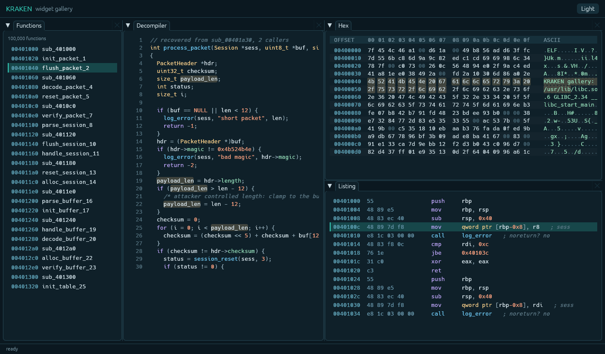

# KRAKEN

KRAKEN is an AI-assisted reverse engineering workbench built on Ghidra's analysis engine. One command registry is exposed through a CLI, an MCP server and (in development) a GUI, so people and AI agents work on the same project and see the same changes. Every edit is logged, attributed and undoable, and agents cannot overwrite your work without your approval. The long-term goal is Rust rewrites of binaries, done function by function and checked against tests.



*GUI preview (in development).*

## Status

**0.1a, pre-alpha.** Linux x86_64 only. CLI and MCP server over a sandboxed Ghidra sidecar (Landlock, no network, scrubbed environment). Expect rough edges and breaking changes.

## Quick start

Needs Rust, JDK 21 and Ghidra 12.1.4. The [getting started guide](docs/getting-started.md) has the details, including the Ghidra checksum.

```sh
export GHIDRA_INSTALL_DIR=/path/to/ghidra_12.1.4_PUBLIC JAVA_HOME=/path/to/jdk-21
cargo xtask ghidra-ext && cargo install --path crates/kraken-cli
export KRAKEN_PROJECT=~/kraken-projects/demo KRAKEN_GHIDRA_HOME=$GHIDRA_INSTALL_DIR
kraken project-create --binary corpus/bin/pie_list-O0 && kraken analyze
kraken list-functions --limit 20
```

Connect an agent: `claude mcp add kraken -- kraken mcp --project ~/kraken-projects/demo`.

## Documentation

- [Getting started](docs/getting-started.md)
- [Concepts for newcomers to reverse engineering](docs/concepts.md)
- [Connecting AI agents](docs/mcp.md)
- [Scripting with the CLI](docs/cli.md)
- [Security](docs/security.md)
- [Command reference](docs/reference/commands.md)
- [Design decisions](docs/design/README.md)

Build the book with `mdbook build docs`. The command reference is generated: run `cargo xtask docs` after changing a command.

## License

GPL-3.0-or-later. See [LICENSE](LICENSE).

Use KRAKEN only on software you are permitted to analyse.
