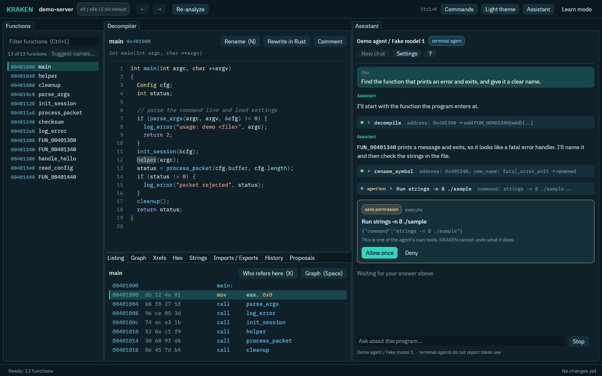

# The built-in assistant

KRAKEN has a built-in assistant for people who are new to reverse engineering. It can explain a function in plain language, give you a guided first look at a program, suggest names for functions that still have generated names like `FUN_00401000`, and answer questions in a chat. It also has an offline glossary of reverse-engineering terms.

The assistant is a client like any other. It reads and edits the project through the same commands as the CLI and MCP server, so everything it does shows up in the edit log, and every run can be undone.

## Two kinds of assistant, one assistant

What answers the assistant can be either of two things, and you can swap one for the other at any time:

| | AI model | Terminal agent |
| --- | --- | --- |
| Examples | Ollama, LM Studio, llama-server, vLLM, Anthropic, OpenAI, Gemini | Claude Code, Codex, Gemini CLI (any ACP agent) |
| Where it runs | A server you point KRAKEN at: your computer or the cloud | A program on your computer that signs in by itself |
| What you need | A model name, and a key for cloud services | The agent's own account; Node.js for the adapters |
| Edits are logged as | `kraken-assistant` | the agent's own name (for example `claude-code`) |
| Besides KRAKEN's tools | nothing | its own tools (shell, files), outside KRAKEN's safety net |
| Good for | Quick answers, a local model that keeps code on your machine | A strong coding agent you already pay for |

Either one works everywhere the assistant does: the **Assistant** tab, **Explain**, the first-run overview, **Suggest names**, and `kraken explain`, `kraken overview` and `kraken auto-name`. The prompts are the same, the answers are parsed the same way (the same explanation card, overview card and name review), and the same approvals apply: a change that would overwrite something you wrote becomes a **proposal** that waits for you, whichever one proposed it.

**How to choose.** Start with a model if you want the assistant to stay inside KRAKEN's safety net, or to keep everything on your computer (a local model). Choose a terminal agent if you already use one, want its stronger reasoning, and accept the notice below. Nothing is lost by switching: the conversation on screen stays, and the new assistant is caught up from it on the next question.

### Choose it in the GUI

Open **Settings > AI** (Ctrl+,). One picker lists the AI models and, below them, the terminal agents with whether each can run here: *Ready*, *Needs setup*, *Not found* or *Not supported here*. Press **Save and use**; the choice is saved as the `[provider]` table of `config.toml`, so the CLI uses it too.

The **Assistant** tab always shows what is answering: the service or agent, the model (a terminal agent says which model it uses once it has started), and whether it runs on your computer, in the cloud, or is a terminal agent.

### Choose it in `config.toml`

Add one `[provider]` table to `~/.config/kraken/config.toml` (`KRAKEN_CONFIG` overrides the location). For a terminal agent:

```toml
[provider]
kind = "terminal_agent"
agent = "claude"          # claude, codex, gemini, or an id from agents.toml
# model = "..."           # optional: ask the agent for this model (see below)
# args = ["--flag"]       # optional: extra arguments for the agent
```

If no provider is configured, the assistant commands stop with an error that shows examples of both kinds.

## AI models

The model must be able to call tools. Examples, one at a time:

```toml
# Ollama (local; run `ollama serve` and `ollama pull <model>` first)
[provider]
kind = "openai_compatible"
base_url = "http://localhost:11434/v1"
model = "qwen3:14b"
```

```toml
# LM Studio (start its server from the Developer tab)
[provider]
kind = "openai_compatible"
base_url = "http://localhost:1234/v1"
model = "your-loaded-model"
```

```toml
# llama-server from llama.cpp (start it with --jinja so tool calls work)
[provider]
kind = "openai_compatible"
base_url = "http://localhost:8080/v1"
model = "local"
```

```toml
# Anthropic. The key stays in an environment variable, never in this file.
[provider]
kind = "anthropic"
api_key = { env = "ANTHROPIC_API_KEY" }
```

```toml
# OpenAI
[provider]
kind = "openai_compatible"
base_url = "https://api.openai.com/v1"
model = "gpt-4.1"
api_key = { env = "OPENAI_API_KEY" }
```

Local models keep everything on your machine. A cloud provider receives the decompiled code and names the assistant reads, so pick one you are comfortable sending that to. Every run prints the provider and model it used on stderr.

In **Settings > AI** you can press **Test connection** (one tiny request; failures are explained in plain words). API keys are never written to `config.toml`. Name an environment variable (read when KRAKEN starts), or paste the key: it is stored in `secrets.toml` next to `config.toml`, created with mode 0600 so only you can read it, and `config.toml` only points at it. The CLI commands read keys from environment variables only, so a pasted key works in the GUI but `kraken explain` needs the variable.

To run a model on your own computer with KRAKEN doing the work (`kraken infer start ... --use`, or **Run a model on this computer** in the same settings section), see [Running a model on this computer](local-models.md).

## Terminal agents

KRAKEN starts a coding agent that you already use in the terminal (Claude Code, Codex, Gemini CLI, or any agent that speaks the Agent Client Protocol, ACP) and connects it to KRAKEN's tools. The agent reads the program you are studying, searches it, renames things and adds comments through KRAKEN's MCP server (`kraken mcp`), as an agent: additive edits are applied, and anything that would overwrite your work becomes a proposal. Every change is logged under the agent's name and is undoable like any other KRAKEN change. For each assistant task KRAKEN starts the agent in the project folder, sends it the same task prompt a model would get, and reads its answer the same way.

### Read this first: what KRAKEN does not protect

Terminal agents bring their own tools. Besides KRAKEN's tools they can usually run shell commands and read, change or delete files on your computer, as you. KRAKEN does not sandbox them and cannot undo what they do to your files. KRAKEN only logs and undoes changes made through its own tools.

- Use an agent you trust, on a project you can afford to lose.
- Read every permission request before you approve it. In the GUI they are cards in the conversation with **Allow once** and **Deny**; unattended commands such as `kraken explain` deny them.
- A program you analyse can be hostile. The agent reads it, and malicious text inside a binary can try to talk the agent into running commands.
- KRAKEN never gives agents its own settings or keys. Each agent signs in by itself.

KRAKEN shows this notice once, the first time you pick or use an agent (in Settings, above the chat, or on the command line), and remembers that it did (`~/.config/kraken/acp-warning.json`). It does not block you; Settings and the chat just wait for you to press *I understand*.

A permission request for one of KRAKEN's own tools is answered by KRAKEN: the command registry's policy is what guards those. Requests for anything else (the agent's shell, its file tools) always go to you. A read-only task (explain, overview) also refuses KRAKEN tools that would change the project.

### Set it up

Setting an agent up (finding Node.js, installing the adapter) is the same from both places:

- **Settings > AI**: pick the agent, press **Set up...**. It shows exactly what would be downloaded (Node.js if needed, and the adapter, with sizes and sources), and asks before it fetches anything. **Test agent** then starts the agent without KRAKEN's tools and asks it for one word, so a missing sign-in shows up here and not mid-conversation.
- The terminal:

```sh
kraken agents list                      # what works on this computer
kraken agents setup claude              # download what is missing (asks first)
claude                                  # sign in once with the agent's own program
```

`kraken agents list` shows one of four states per agent:

| State | Meaning |
| --- | --- |
| `detected` | Ready. |
| `available` | Not installed yet; `kraken agents setup <id>` (or Set up in Settings) installs it. |
| `missing` | Cannot run until you install something; the reason says what. |
| `unsupported` | This computer cannot run it (for example RISC-V 64). |

| Id | Agent | How KRAKEN starts it |
| --- | --- | --- |
| `claude` | Claude Code | the `claude-agent-acp` adapter, installed by `kraken agents setup claude` |
| `codex` | Codex | the `codex-acp` adapter, installed by `kraken agents setup codex` |
| `gemini` | Gemini CLI | your own `gemini --acp` if `gemini` is on `PATH`, else installed by `setup` |

You need an account with the agent's vendor. Sign in with the agent's own program first (`claude`, `codex login`, `gemini`). If you have not, KRAKEN says so: "needs you to sign in first".

**Model and extra arguments.** `model` asks the agent for a model in the way that agent supports: Claude Code through `ANTHROPIC_MODEL`, Codex through `-c model="..."`, Gemini CLI through `--model`. A custom agent has no known way, so its model is left to the agent. `args` are appended to the agent's own arguments. Leave both out to let the agent choose.

### Node.js

The adapters are JavaScript and need Node.js (22 or newer for Claude Code). KRAKEN looks for one on your `PATH`. If there is none, setup offers to download a pinned Node.js 24 LTS into KRAKEN's own folder (`~/.local/share/kraken/agents`) on Linux x86-64, macOS Apple silicon and Windows x86-64. On other systems install Node.js yourself. Nothing is installed system-wide.

Setup asks before it downloads anything (`kraken agents setup` takes `--yes` to skip the question), and tells you what and from where:

- Node.js comes from nodejs.org over HTTPS. KRAKEN checks the download against a SHA-256 that is built into KRAKEN before it unpacks a single file.
- The adapter comes from the npm registry with a lockfile that is built into KRAKEN: exact versions and an integrity hash for every package. Install scripts are switched off (`--ignore-scripts`); none of the three adapters needs them. Your own `.npmrc` is ignored.

### What the agent can see

KRAKEN builds the agent's environment from scratch. It gets `PATH`, `HOME`, locale, proxy and certificate settings and the agent's own config-folder variable (`CLAUDE_CONFIG_DIR`, `CODEX_HOME`, `GEMINI_CLI_HOME`). It does not get API keys, and nothing starting with `KRAKEN_` ever. If you want an agent to use an API key from your environment, say so explicitly in `~/.config/kraken/agents.toml`:

```toml
[env_allow]
claude = ["ANTHROPIC_API_KEY"]
```

On Linux, KRAKEN starts the agent in a small sandbox (user, mount and PID namespaces, no root needed) that hides KRAKEN's runtime directory and the user token inside it. The agent's KRAKEN tool server still reaches the daemon, but only with the agent credential, which cannot approve anything. Everything else (your files, tools, network, sign-in) works as before. Two consequences: programs that need `sudo` or other setuid helpers do not work inside the agent, and if the daemon restarts the agent must be restarted too.

If your system does not allow unprivileged user namespaces, you get a warning (a note in the conversation, or on stderr), the agent gets no daemon connection, and it is not protected from reading the user token. On macOS and Windows this protection does not exist yet. See [Security](security.md).

### Other ACP agents

Any agent that speaks ACP over stdio can be added in `~/.config/kraken/agents.toml`:

```toml
[[agent]]
id = "goose"
name = "Goose"
command = "goose"
args = ["acp"]
env_allow = ["GOOSE_*"]      # optional
```

It then appears in `kraken agents list` and in the Settings picker, and `agent = "goose"` selects it.

### Raw sessions: `kraken agents run`

```sh
kraken agents run <id> --project <dir> "<prompt>"
```

This runs one prompt in an agent without the assistant's task prompts and result parsing: the agent's answer streams to stdout; tool calls, its plan and permission answers go to stderr (`--json` prints one JSON event per line). The agent gets `kraken mcp --project <dir>` (add `--daemon` for `kraken mcp --daemon`, which shares the open project and Ghidra with the GUI and the CLI). Permission requests are asked on the terminal (type the number of your choice; anything else declines; without a terminal they are declined; `--auto-approve` allows everything and is dangerous). Ctrl-C cancels the turn. KRAKEN's tools are described in [Connecting AI agents (MCP)](mcp.md).

### Troubleshooting

- `needs you to sign in first`: run the agent's own program once and sign in, then **Test agent** in Settings.
- `did not answer within 60 seconds`: the agent printed something instead of speaking ACP; the last lines it wrote are shown. Run the agent's own program to see what is wrong.
- Agent still running after a crash: KRAKEN stops the agent and everything it started (SIGTERM, then SIGKILL) when the command ends or the project closes, and the agent is killed if KRAKEN itself dies.

## Rewriting uses the same assistant

The rewrite pipeline (`rewrite_function`, its repair attempts, spec mode, and `rewrite_program`; see [ADR 0013](design/0013-rewrite-pipeline.md)) makes every model call through the same backends as the assistant: a model API or a terminal agent, chosen by the same `[provider]` table. A `kind = "terminal_agent"` provider therefore works for rewriting too, and so does any local or cloud model.

To use a different one for rewriting only, add an optional `[rewrite]` table. It takes exactly the keys of `[provider]` and, when present, replaces it for the rewrite commands (the assistant keeps using `[provider]`):

```toml
[provider]                 # the assistant: a local model
kind = "openai_compatible"
base_url = "http://localhost:11434/v1"
model = "qwen3:14b"

[rewrite]                  # rewrites: Claude Code
kind = "terminal_agent"
agent = "claude"
```

`[rewrite]` alone also works. The file is read on every call, so a change applies to the next rewrite without restarting `krakend`. A rewrite with no provider anywhere stops with the same error that shows examples.

**What a terminal agent does here.** A rewrite request is plain text in, plain text out. KRAKEN starts the agent in a fresh, empty scratch folder (not the project), without the KRAKEN tool server, and sends it the same prompts a model gets, after a short note that this is a text-only request. The agent answers with the translation or the spec in the usual format: Rust between `<kraken-rust>` tags and the `<kraken-result>` block, or the Markdown spec. KRAKEN parses it, lints it, and builds and tests it in its own sandbox. The agent does not build or test anything, and it cannot write files or run commands for KRAKEN: every permission request for the agent's own tools (its shell, its file tools) is denied during a rewrite, with no prompt, and KRAKEN notes that it happened. A tool the agent may use without asking (by its own settings or an auto-accept mode) is outside what KRAKEN can stop, as everywhere else in this page. The scratch folder is only its working directory, not a sandbox: the prompt carries code and strings from the binary, so a tool the agent runs on its own can still read your files. If that matters for a binary, use a model API for `[rewrite]`, or run the agent with its tools turned off in its own settings. Each model call is a new agent session, so a repair attempt is a new request that carries the failed code and the counterexample, as it is for a model.

As with any terminal agent, the decompiled code of the functions being rewritten goes to the agent's service. Models served on your own computer keep it there.

## Commands

All of them take `--project <dir>` (or `KRAKEN_PROJECT`) like the other commands, and use whatever the `[provider]` table selects, a model or a terminal agent. Text streams to standard output and tool calls go to standard error, so you can see what the assistant looked at. With `--json`, standard output holds one structured result instead (it says which kind of backend answered).

### `kraken explain <address>`

Explains the function at an address: a short explanation, what it does step by step, and names worth considering. It cannot change the project.

```sh
kraken explain 0x401000
```

### `kraken overview`

A guided first look: what the program appears to be, its main parts, a few functions to open first and why, and what to do next. It starts from `project_info`, so run `kraken analyze` first. Where this build of KRAKEN has no command for something it would like to check (strings, imports, cross-references), the assistant says so and the result lists it under "Could not check" rather than guessing.

### `kraken auto-name [--limit N] [--dry-run]`

Looks at up to N functions (default 10, at most 50) that still have default names, and suggests names and short comments with the evidence for each.

- `--dry-run` only suggests. A model is not even offered the commands that write; a terminal agent is told not to write.
- Without it, suggestions are written as an agent (`kraken-assistant` for a model, the agent's own name for a terminal agent). Following the usual agent rules, a rename of a function that still has its default name and a new comment are applied right away; anything that would overwrite something a person wrote becomes a **proposal** that waits for you (`kraken proposals-list`, then `kraken proposal-accept`). A model run makes at most two edits per function it was allowed to look at; a terminal agent's edits are bounded by the registry's per-run cap.
- Undo everything a run did with `kraken undo-run --run-id <id>`. The run id is printed at the end.

Each suggestion carries a confidence label of low, medium or high. KRAKEN works it out itself by counting how many independent kinds of evidence agree (strings the function uses, library functions it calls or imports, how its callers use it, what it calls). The model's own opinion of its confidence is ignored. The label is a rough guide to what to review first. It is not a probability and is not calibrated.

### `kraken glossary <term>`

Looks up a term or an instruction mnemonic. It works offline and needs no project or provider.

```sh
kraken glossary stack frame
kraken glossary jne --arch x86_64
kraken glossary adrp
```

Typos are forgiven (`dissasembler` finds `disassembler`), and a query can match related terms too. `--json` prints the matches with their notes.

## In the GUI



*The Assistant tab with a terminal agent selected, driven by KRAKEN's scripted test agent so the picture is reproducible. A model API looks the same, without the permission card.*

The GUI has one **Assistant** tab (next to Hex) and the same features whichever kind answers, with every step visible:

- **Chat.** Ask in your own words. Each tool call shows as a small chip (command, short arguments, result) that opens for details; a terminal agent's own tools carry an *agent tool* tag. Changes the assistant is not allowed to make on its own (overwriting something you set) appear inline as proposals with **Accept** and **Reject**; accepting applies them as your own edit. A terminal agent asking to use one of its own tools shows a permission card with **Allow once** and **Deny**. **Stop** cancels and withdraws waiting requests. The backend in use, the model, whether it runs on your computer, in the cloud or as a terminal agent, and (for models) the tokens used are always shown.
- **Explain.** Right-click code in the decompiler (a word, its line, or the whole function) or a function in the list, then choose Explain. The answer is a card with clickable addresses and names you can try with one click (the rename box opens pre-filled; nothing changes until you confirm).
- **First run.** When the first analysis finishes a banner offers an overview of the program.
- **Suggest names.** The button above the function list asks for names for placeholder-named functions. You get a review table (old name, new name, evidence, how sure) and nothing changes until you press Apply. Applied names are your own edits, and Undo takes them back.
- **Learn mode.** The switch in the top bar adds a "?" to panel tabs and explains terms and assembly instructions on hover.

With the daemon (the default) a terminal agent gets `kraken mcp --daemon --project <dir>`, so its edits reach the window as they happen, with the usual notification and Undo. With `--no-daemon` the agent uses its own session on the project and the window refreshes when each turn ends. Changing the project ends the agent's session; the next question starts a new one.

## How it stays safe

The assistant reads code that came from a file you do not trust, so the same rules apply as for any agent (see [Security](security.md)):

- Names, strings, comments and decompiled code reach the model only as delimited, untrusted data, and the model is told never to treat them as instructions. They are never put in the system prompt.
- Which commands a model may call is decided by KRAKEN for each task, not by the model or the binary. Explaining and the overview are read-only. Opening, creating or rebuilding projects, undoing, deciding on proposals, and starting rewrites (translating, specs, accepting and exporting rewrite units) are never offered to the assistant as tools (the rewrite pipeline itself uses the same backends, as plain text requests; see above). Dangerous commands are never offered either. A terminal agent is told the same task rules, but it holds KRAKEN's tool server rather than a list KRAKEN chose: in a read-only task KRAKEN refuses its permission requests for KRAKEN tools that write, and the result calls out any change made anyway. The project's own `kraken mcp` server is bound to the project (it cannot open another).
- Edits go through the registry's policy: additive edits are applied up to a per-run cap, overwrites become proposals.

## Measuring the assistant (`kraken eval`)

Which model, or which agent, is good enough? `kraken eval` answers that with numbers. It runs scripted tasks over KRAKEN's test corpus (small programs built with debug information, so the right answers are known), asks the assistant you configured, scores what comes back, and writes a report.

| Kind | What is asked | How it is scored |
| --- | --- | --- |
| `name_functions` | Name 6 to 8 functions of a stripped program | For each function, the F1 of the words in your name and the words in the real (DWARF) name: `parse_header` and `header_parse` score 1, `parse_file` scores 0.5. Plural `s` and filler words (`fn`, `do`, `the`) are ignored. The task score is the mean |
| `find_function` | "Which function reverses a string in place?", "Which function uses the string `stack underflow`?" | 1 if the address answered lies inside the right function, else 0 |
| `question` | "Does the program import `strcmp`?", "List every imported function that does not start with an underscore", "What format string prints the final result?" | Yes/no and text are right or wrong; a list scores the F1 of its members |

There are 27 tasks over four programs (a bytecode VM, an expression evaluator, a linked list with function pointers, a statically linked string toolbox). The programs are the stripped builds, so names cannot be read off. The questions describe behaviour, never the answer, and nothing from a binary is put in a prompt. `kraken eval list` shows all of them.

The assistant gets the same read-only tools it has everywhere else and a fixed answer format: its reply ends with a block such as `<kraken-answer>{"address": "0x101255"}</kraken-answer>`. A reply with no readable block scores 0 and the report says why. The tasks are read-only: a model is not offered the commands that write, and a terminal agent is told not to and has its write requests refused.

### Run it

```sh
kraken eval run --out results/qwen3-14b
```

This uses whatever the `[provider]` table of `config.toml` selects, an AI model or a terminal agent, exactly like `kraken explain`. For each program in the corpus it creates and analyses a project under the output folder (this needs the engine, so run `kraken setup` first, or use the offline modes below), then asks every task of that program in turn. Progress goes to standard error, one line per task.

Useful options:

- `--task find/ --task name/switch_vm` runs only the tasks whose id starts with one of these. `--kind question` runs one kind. `--limit 5` stops after five.
- `--timeout 300` cancels a task that runs longer than five minutes (default 900 seconds); it scores 0 with the reason.
- `--price-in 3 --price-out 15` (dollars per million tokens) adds a cost estimate for a paid API. Leave them out for a local model.
- `--min-score 0.6` makes the command exit with status 1 when the mean score is lower, so a script or a CI job can gate on it.
- `--json` prints the whole report on standard output.
- `--corpus DIR` points at the repository's `corpus/` folder when `kraken` is not run from inside a checkout (or set `KRAKEN_CORPUS`).

### Against a local model (Ollama, llama-server)

Point the provider at the server, as in [AI models](#ai-models), and run the evaluation. The model has to call tools; for llama-server start it with `--jinja`.

```toml
# ~/.config/kraken/config.toml
[provider]
kind = "openai_compatible"
base_url = "http://localhost:11434/v1"   # Ollama; llama-server is http://localhost:8080/v1
model = "qwen3:14b"
```

```sh
ollama serve &              # in another terminal
ollama pull qwen3:14b
kraken eval run --out results/qwen3-14b --timeout 600
```

Local models are slow and the tasks are many small conversations, so start with `--limit 6` or `--kind find_function`. To compare models, change `model` and run again with another `--out`; the numbers in `report.json` line up task by task. Tokens are counted when the server reports usage (most OpenAI-compatible servers do; the report says "not reported" when one does not), and a local model has no price. To measure a model KRAKEN runs for you, start it first with `kraken infer start ... --use` ([Running a model on this computer](local-models.md)) and then run the same command.

### Against Claude Code (or another terminal agent)

```toml
[provider]
kind = "terminal_agent"
agent = "claude"
# model = "..."          # optional; see Terminal agents
```

```sh
kraken agents setup claude          # once
kraken eval run --out results/claude-code
```

KRAKEN starts the agent once per task in the task's project, with the `kraken mcp` server attached, and sends it the task. The agent and `kraken eval` share the daemon (the default), so run without `--no-daemon`. Three things to know:

- **The agent's own tools are outside KRAKEN's safety net** (see [Terminal agents](#terminal-agents)). Nothing is there to answer a permission request during an evaluation, so requests for the agent's shell or file tools are denied, and a task that insists on them scores what it can. Run evaluations on the corpus, not on a program you are worried about.
- **Tokens and cost are not reported** for a terminal agent (ACP does not carry them), so the report says so; look at the agent's own usage page for the bill.
- A strong agent is not a deterministic one. Run twice when two results are close.

### The report

`--out` receives:

- `report.json`: backend, mode, engine, totals (mean score, by kind, tokens, cost, tool calls) and one entry per task with its score, the expected and given answer, the reply, stop reason, tokens, tool calls and the full transcript. The format is versioned (`schema_version`).
- `report.md`: the same as a readable summary with a table of tasks and, for each miss, what was expected and what was answered (for names, a table of address, real name, your name and F1).
- `transcripts/<task>.md`: what the assistant was asked, what it said, every tool call with a short result. Read the weakest ones first.
- `projects/`: the projects made for the run. Delete the folder when done.

### Offline and deterministic: the CI modes

Two modes need no model, no network and no decompiler, and give the same report every time (timings are left out):

```sh
kraken eval run --backend ci-replay --out /tmp/eval-replay   # replays a cassette through ReplayProvider
kraken eval run --backend ci-agent  --out /tmp/eval-agent    # runs the scripted fake terminal agent
```

The tools run on `engine-fake` over the corpus fixtures (recordings of a real Ghidra), and the answers come from a script written by a deterministic **stand-in**: it answers from the ground truth and gets some tasks wrong on purpose (one name in three right, one half right, one wrong; every fourth function answer off by one; one question left unanswered), so every kind of score and every failure shows up. `ci-replay` feeds that script to the API path as a cassette; `ci-agent` feeds the same script to the fake ACP agent (the `kraken` binary itself, via its hidden `agents __fake-agent`) over the real ACP host. Both produce the same scores.

A CI score proves the harness, the scoring and both backends work. It says nothing about any model. The cassette and script live in `crates/kraken-eval/data/`; after a change to the suite, run the `kraken-eval` tests with `KRAKEN_EVAL_BLESS=1` to rewrite them (the tests fail with that advice when they are out of date).

### Recording a real model for replay

```sh
kraken eval run --out results/run1 --record results/run1/cassette.json
kraken eval run --backend ci-replay --cassette results/run1/cassette.json --out results/replay1
```

`--record` saves every exchange of a model API as an eval cassette: the responses of each task's model calls, in order. Replaying it runs the same tasks against the fixtures with the recorded answers, so a scoring change can be checked on real answers without paying for them again. A cassette is keyed by task id and call number, not by a hash of the request, so changing a tool description does not invalidate it. If the tools would have behaved differently, the replay shows it.

### Your own tasks

A suite is a JSON file passed with `--suite`. Each task has an `id`, a `kind`, a corpus `binary`, a `question` and an `expect` (`function`, `yes_no`, `set` or `text`); naming tasks need only a `sample` size. See `crates/kraken-eval/data/corpus.json`. Names are only a test on a stripped binary, so `name_functions` refuses an unstripped one.

## For developers

The `kraken-eval` crate is the harness: `Suite` and `TaskDef` (tasks and the truth they resolve to), `score` (answer reading and scoring), `Runner` over an `Environment` (opens the corpus binaries: `ci::FixtureEnvironment` offline, the CLI's live environment otherwise) and an `AssistantSource` (`ApiSource`, `RecordingSource`, `ReplaySource`, `FakeAgentSource`, or a closure), and `Report`. It asks through `kraken_assist::Assistant` with a `Task::custom`, so a model API and a terminal agent are measured the same way.

The `kraken-assist` crate holds the logic and has no GUI dependencies:

- `AssistBackend` is what answers a run, with two implementations: `ApiBackend` (a `kraken_agent::ChatProvider` driven by the agent loop over a `RegistryToolHost`) and `AcpBackend` (a terminal agent driven by `kraken_acp::AcpHost`, reaching the registry through the `kraken mcp` server it is launched with). Both turn a `RunSpec` into the same `AgentRun`: a stream of `AgentEvent`s (text deltas, tool call started and finished, approval required, proposals, done with a stop reason). ACP updates are mapped onto it: message chunks become text deltas, tool calls become chips named after the KRAKEN command, permission requests become `ApprovalRequired`, and the agent's turn ending becomes `Done`.
- `RegistryToolHost` implements `kraken_agent::ToolHost` over a registry and any `kraken_host::backend::CommandBackend` (an in-process session or `krakend`). It starts jobs such as `analyze` and waits for them with `job_await`, and returns proposed writes with a top-level `"proposal"` field so the agent loop emits `ProposalCreated`.
- `Task::explain_function`, `explain_selection`, `overview` and `auto_name` each bundle a prompt, a tool subset and budgets; `Assistant::run` runs one on either backend and parses the result block the model ends with.
- `plan_agent` finds an agent in the catalogue, applies the chosen model and arguments and checks that it can run.
- `Glossary::builtin()` gives `get`, `mnemonic` and fuzzy `lookup` for learn-mode tooltips.
