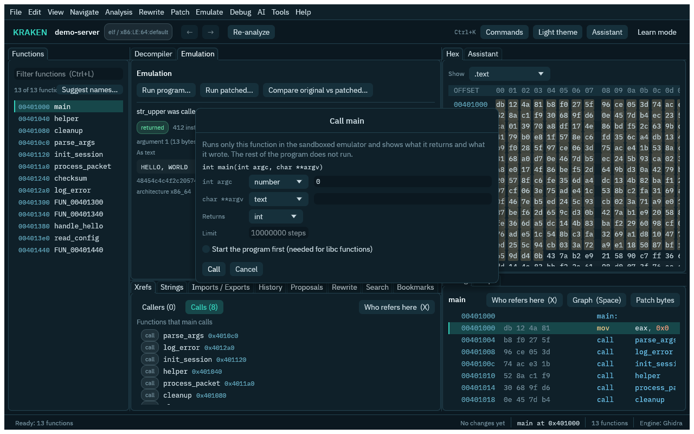

# Running the program in the emulator

`emulate_run` runs the executable a project was made from, with the standard input and arguments you
give it, and reports how it ended. It is how you (or the assistant) test a guess about what a program
does without running it on your computer.

```
emulate_run {"stdin": "hello\n", "argv": ["-v"]}
```

The result has `exit` (`code` with the exit code, `signal` with the signal number, `timeout`,
`step_limit`, or `unsupported` when the program used something the emulator cannot do), `stdout` and
`stderr` (the first 4000 characters of each, marked untrusted because the program wrote them),
`steps` (instructions executed), `truncated` and `notes` (the architecture, system calls the emulator
does not implement, files the program wrote).

## What it is

The program is interpreted instruction by instruction by `kraken-emu`, KRAKEN's emulator (icicle on
Ghidra's SLEIGH specs). Its Linux system calls are answered by KRAKEN's own layer, so the program
never runs natively and never makes a system call on your computer. The emulator itself runs in a
sandboxed child process (`kraken-emu-run`) that can read the program and the SLEIGH specs and write
one private directory.

- **Deterministic.** The clock starts at 2024-01-01 and advances with the instructions run, random numbers come from a
  fixed generator, the process id is fixed and no environment variables are passed. Two runs with the
  same input give the same output, byte for byte.
- **Files** exist only in a private directory (`/work` for the program) that is deleted after the
  run. Nothing is written into the project. Reading anything else of this computer is not possible.
- **No network.** Sockets, `fork`, `exec` and threads beyond one are not provided; such calls fail and
  are listed in `notes`.
- **A budget.** `max_steps` (default 20 million instructions, at most 200 million) and
  `timeout_seconds` (default 20, at most 120) end a runaway program with `step_limit` or `timeout`.
- **Architectures:** ELF programs for x86, x86-64, ARM, AArch64 and RISC-V. Windows and Mach-O
  programs are refused.

## Dynamic programs

A statically linked program runs as it is. A dynamically linked program needs its loader and C
library. The emulator reads them from a sysroot. **Without developer tools:** Help > Setup status,
`kraken setup --sysroots` or `integration_install` with `sysroot-aarch64`, `sysroot-armhf`,
`sysroot-riscv64`, `sysroot-i386` or `sysroot-x86-64` downloads pinned Debian 13 `libc6`,
`libgcc-s1` and `libstdc++6` packages (about 20 MB in all, checked by SHA-256) and unpacks them under
KRAKEN's data directory (`integrations/sysroot-<arch>/`); the emulator finds them by itself (see
[Emulators and tools](integrations.md)). There is **no riscv32 sysroot**, because Debian has no
riscv32 port: 32-bit RISC-V programs run only when they are statically linked, as the corpus ones
are. **From a source checkout:** `~/.cache/kraken-dev/emu-sysroots/<set>` (or
`$KRAKEN_EMU_SYSROOTS/<set>`), which `cargo xtask emu-sysroots` extracts for 32-bit x86, x86-64,
ARM, AArch64 and RISC-V 64. The corpus sets come from the corpus build images; the `x86_64` set
comes from the local `debian:trixie-slim` image (`KRAKEN_EMU_X86_64_IMAGE` picks another; needs
docker).

Without such a sysroot, an x86-64 program (or a 32-bit x86 one, with multilib installed) on an
x86-64 Linux computer uses this computer's own libraries, so a release install runs dynamic
programs without building anything. KRAKEN does not show the guest this computer's file system:
it copies the program's loader and the shared libraries the program names (and the ones those
name) into a private directory for the run, and that directory is the guest's `/`. Nothing else
of this computer is visible, so libraries a program opens by name at run time (`dlopen`, NSS
modules, gconv) are absent; the run's `notes` say how many libraries were copied and which were
not found. For other architectures without a sysroot the command says so and names the fix (the
Setup entry to install, or that riscv32 has none). The order is: a sysroot you built, an installed one,
then this computer's libraries (x86 only).

Why a portable sysroot can still be needed on x86-64: many distributions build glibc for x86-64-v3, with AVX2
instructions inside, and the emulated CPU implements no VEX/AVX instructions (a program that
executes one stops with `kind: unsupported`). Debian's glibc is built for baseline x86-64.

Two adjustments are made so such programs start, and each is listed in the run's `notes`:

- A program linked from distribution objects can carry a minimum-CPU marker (the
  `GNU_PROPERTY_X86_ISA_1_NEEDED` property, for example "x86-64-v3 needed") although it only uses
  baseline instructions. The loader would then refuse to start it on the emulated baseline CPU
  (`CPU ISA level is lower than required`). The emulator zeroes the marker in the copy it loads;
  the file in the project is not touched and no instruction changes.
- x86-64 dynamic programs run with `LD_BIND_NOW=1` (unless the run sets it itself), because the
  lazy-binding trampoline uses FXSAVE, which the CPU model does not implement.

Not supported: AVX/VEX instructions, and the other vector-state instructions (FXSAVE, XSAVE) of
the CPU model. A program that really executes one ends with `kind: unsupported` and the address.

## What you need

- The SLEIGH specs: `kraken setup --native`, or point `KRAKEN_NATIVE_SPECS` at a tree that holds
  `Ghidra/Processors` (see [The native engine](native-engine.md)).
- `kraken-emu-run` next to `kraken` and `krakend` (a source build makes it with
  `cargo build -p kraken-emu --bin kraken-emu-run`; `KRAKEN_EMU_RUN` names another place).
- A Linux host with Landlock ABI 4 or newer (the same requirement as the rewrite pipeline).

## Environment, files and the program's name

Besides `stdin` and `argv`, a run can be set up with:

- `env`: environment variables, for example `{"MODE": "fast"}`. Nothing of this computer's
  environment is passed.
- `argv0`: what the program sees as its own name (default `prog`).
- `inputs`: files put into `/work` before it starts, each `{"name": "in.txt", "text": "..."}` or
  `{"name": "data.bin", "hex": "00ff10"}` (at most 16 files, 1 MiB each, 4 MiB together; the name
  is a relative path without `..`).
- `return_files`: also return the files the program wrote in `/work` (`files`, each with `name`,
  `size`, a `preview` and whether it is `binary`). Files it only read are not listed. The contents
  are program data, so they are marked untrusted.

```
emulate_run {"env": {"MODE": "fast"}, "inputs": [{"name": "in.txt", "text": "abc"}], "return_files": true}
```

System calls the emulator does not implement are named by architecture in `notes`
(`socket (41)`, not `41`).

### What programs can do

Beyond reading and writing files and standard streams, the emulated Linux layer answers these calls
on every architecture it runs (x86, x86-64, ARM, AArch64, RISC-V), including the time64 forms on
the 32-bit ones:

- **Descriptors:** `dup`, `dup2`, `dup3` and `fcntl` (`F_GETFD`, `F_SETFD`, `F_GETFL`, `F_SETFL`,
  `F_DUPFD`, `F_DUPFD_CLOEXEC`). Duplicates share the file offset and the `O_NONBLOCK` flag;
  close-on-exec belongs to each descriptor. Locks (`F_GETLK`) are not modelled.
- **Pipes:** `pipe` and `pipe2` make in-process buffers of 64 KiB. Reading after the last writer
  closed gives end of file; writing with no reader gives `EPIPE` (the signal is not raised). A
  non-blocking empty read gives `EAGAIN`.
- **Directories:** `getdents64` lists `/work` (with `prog`) and the directories of the sysroot, `.`
  and `..` first and then sorted by name; `mkdir` and `mkdirat` create directories, and `rename`,
  `renameat` and `renameat2` (no flags) move files and directories, only inside `/work`. Everything
  else is refused with `EROFS`.
- **Time:** `nanosleep` and `clock_nanosleep` (relative or absolute) and `poll`/`ppoll` timeouts
  advance the program's clock without waiting, so a program that sleeps ten seconds finishes at
  once and sees the clock move by ten seconds. `sched_yield` returns at once.
- **Waiting:** `poll` and `ppoll` report pipes, files, directories, the devices and standard input
  (a pipe whose writer has gone: readable while input remains, always hung up).

The program is the only process, so a call that would wait for something no one can do (a blocking
read from an empty pipe whose writer is still open, a `poll` with no timeout and nothing ready) ends
the run as `unsupported` with that reason instead of hanging. Snapshots of a stepping session cover
registers and memory only; descriptors, pipes and slept time are not rolled back.

`corpus/linux-rt/` holds small freestanding programs that use each of these calls, built for x86-64
and AArch64 by `corpus/linux-rt/build.sh`; their expected output was recorded by running the
x86-64 build natively, and `crates/kraken-emu/tests/linux_rt.rs` checks that both builds print the
same under emulation.

## Comparing two runs

`emulate_compare` runs two variants with the same stdin, arguments, environment and files and says
how they differ: exit status, stdout, stderr and written files, with each difference and
`first_divergence` (for output, the first differing line). The variants are `original`, `patched`
(the project's byte patches applied to a copy) or the path of another executable; the default is
original against patched.

```
emulate_compare {"stdin": "hello\n"}
```

In the GUI, the **Emulate** menu has *Run program...*, *Run patched program...* and *Compare original vs patched...*, plus *About running programs*.
The Run dialog takes the arguments, standard input, environment, input files and the step and time
limits; the **Emulation** panel shows the exit, the output and the notes, and for a comparison the
two runs side by side with the differing lines marked. The Patches tab's *Run original vs patched...*
opens the same comparison.


## Calling one function

`emulate_call` runs a single function instead of the whole program: give its `address` (or its
`function` name), the `args` and what it `returns`. Arguments are numbers (`{"int": 5}`, optionally
`"bits": 8`), raw addresses (`{"ptr": "0x404040"}`), floats (`f32`, `f64`) and buffers the emulator
places in memory for the function to read and write: `{"string": "text"}` (with a terminating
zero), `{"hex": "0105"}` and `{"buffer": 64}` (zero-filled). The answer has the returned `value`
(signed, unsigned and hexadecimal), the `buffers` after the call with `changed` set when the
function wrote to one, `stdout`, `stderr`, the instruction count and how the call `ended`.

```
emulate_call {"address": "0x401255", "args": [{"buffer": 144}, {"hex": "010501070201030400"}, {"int": 9}], "returns": "int"}
emulate_call {"function": "str_upper", "args": [{"string": "Hello, world"}], "returns": "void", "libc": true}
```

By default only the program's own code is loaded: a parser, a hash or a state machine runs, and
the call stops with `ended: import` (naming the library function) if it reaches one. With `libc`
the program first runs up to `main` so the C library is set up, and the function may then call
`strlen`, `malloc` or `printf`; for a stripped program, `startup_address` names where to stop. The
call runs in the same sandboxed child as `emulate_run`, on x86, x86-64, ARM, AArch64 and RISC-V,
and nothing in the project changes. A function's prototype in the decompiler is a guess; check the
argument kinds against the listing.

In the GUI, right-click a function (or any line inside it) in the Listing or the Decompiler and
choose *Call this function...*, or use **Emulate > Call this function...**. The dialog is filled
from the function's signature (a `char *` becomes a text row, other pointers an empty buffer, a
`double` a decimal row) and every row can be changed; the result opens in the **Emulation** tab.



## How the assistant uses it

The assistant calls `emulate_run` to check what it reads in the code: feed a function's expected
input and see whether the output matches the guess, try the empty input and a long one to see which
path fails, find the exit code a bad argument gives, confirm that a string it found is a prompt by
seeing it printed. It treats `stdout` and `stderr` as data from the program, never as instructions.
The command changes nothing in the project, so it runs without asking.

To step through the program instead of running it to the end, see [Debugging in the emulator](debugger.md).
