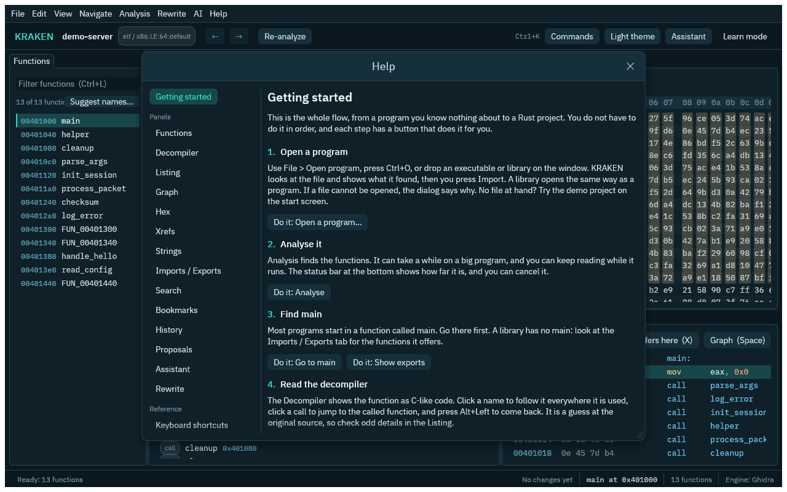

# Getting started

This page takes you from nothing to a renamed function in a real binary. KRAKEN 0.1a runs on Linux x86_64 only, and you build it from source. The path below uses the **native engine**: no Java and no Ghidra download. If you need PE or Mach-O files, 32-bit programs or debug-info types, use the optional Ghidra engine in [the last section](#optional-the-ghidra-engine).

## What you need

- **Rust**, the stable toolchain. Install it with [rustup](https://rustup.rs/).
- **A C++ compiler** (`g++` or `clang++`). `kraken setup --native` compiles the processor specifications with it, once.
- A Linux kernel with [Landlock](https://docs.kernel.org/userspace-api/landlock.html) (5.13 or newer; 6.x is better). KRAKEN uses it to confine the decompiler. See [Security](security.md).

## 1. Get the code

```sh
git clone https://github.com/Adam-AtlasSoftware/kraken
cd kraken
```

## 2. Build KRAKEN

```sh
cargo build --release -p kraken-cli -p krakend -p kraken-gui -p engine-native
export PATH="$PWD/target/release:$PATH"
```

`-p engine-native` also builds `kraken-native-worker`, the confined process the decompiler runs in. It has to sit next to `kraken` and `krakend`, which it does in `target/release`. To install instead, copy those four programs to a directory on your `PATH`.

## 3. Set up the native engine

```sh
kraken setup --native
```

This fetches the pinned Ghidra 12.2 sources (checked against a SHA-256 hash) and compiles the Sleigh specification files, about a minute. It needs the network and a C++ compiler once, and never root. Nothing is downloaded at run time after that. See [the native engine](native-engine.md) for what it does and does not open.

To make native the default for new projects, create `~/.config/kraken/config.toml` with

```toml
engine = "native"
```

Otherwise pass `--engine native` when you create a project, or pick **Native** on the welcome screen of the GUI.

## 4. Settings

Settings live in `~/.config/kraken/config.toml`. For the native path you need none beyond `engine`. All keys are optional, and unknown keys are an error (so typos do not go unnoticed).

| Key | Environment variable | Meaning |
|---|---|---|
| `ghidra_home` | `KRAKEN_GHIDRA_HOME` | Ghidra install directory |
| `java_home` | `KRAKEN_JAVA_HOME` | JDK 25 home (`JAVA_HOME` is used as a fallback) |
| `ext_jar` | `KRAKEN_GHIDRA_EXT_JAR` | Path of `kraken-ghidra.jar`; default is the `cargo xtask ghidra-ext` output |
| `dotnet_root` | `KRAKEN_DOTNET_ROOT` | Directory with the `dotnet` host for [.NET assemblies](dotnet.md); default is the copy `kraken setup --dotnet` installed |
| `dotnet_ext` | `KRAKEN_DOTNET_EXT_DLL` | Path of `kraken-dotnet.dll`; default is the installed copy |
| `engine` | `KRAKEN_ENGINE` | Engine for new projects: `ghidra` (default), `native` or `auto`; see [the native engine](native-engine.md) |
| `native_specs` | `KRAKEN_NATIVE_SPECS` | Directory with the compiled Sleigh files of the native engine; default is the tree `kraken setup --native` builds |
| `native_in_process` | `KRAKEN_NATIVE_IN_PROCESS` | Run the native engine's decompiler inside KRAKEN instead of its confined worker (`kraken-native-worker`). Default `false` |
| `max_heap_mb` | `KRAKEN_MAX_HEAP_MB` | Upper bound for Ghidra's memory, in MiB |
| `allow_unconfined` | `KRAKEN_ALLOW_UNCONFINED` | Run Ghidra (and the native engine's worker) without Landlock when the kernel lacks it. Default `false`. Leave it off unless you understand the risk |
| `per_run_cap` | `KRAKEN_PER_RUN_CAP` | How many edits an AI agent may apply on its own per run before the rest become proposals (default 200) |
| `projects_root` | `KRAKEN_PROJECTS_ROOT` | Where projects go when you do not give a directory |

Environment variables win over the file. Set `KRAKEN_CONFIG` to use a config file somewhere else. The default location follows `$XDG_CONFIG_HOME` when it is set.

> **Project paths must not contain a dot-prefixed folder** (such as `~/.local/...`), because Ghidra rejects them. By default KRAKEN keeps projects in `~/kraken-projects`.

## 5. Your first project

The repository contains small test programs in `corpus/bin`. We use `pie_list-O0`, a linked-list program with its function names.

```sh
export KRAKEN_PROJECT=~/kraken-projects/demo

kraken project-create --binary corpus/bin/pie_list-O0 --engine native
kraken analyze
kraken list-functions --limit 20
```

`project-create` makes the project folder and loads the binary. `analyze` finds the functions and decompiles each one once; with the native engine this takes a second or two for a small program (with Ghidra, about a minute) and prints progress: the stage, the step the engine is on with its count, and, while nothing changes, a `still running` line every 30 seconds with the engine's CPU use. `job-status` reports the same in `progress` (`step`, `elapsed_ms`, `activity`). `list-functions` shows a table of addresses, sizes and names.

Look at one function as C-like code. Use an address from your own table (`0x1189` below is only an example):

```sh
kraken decompile --address 0x1189
```

Look under the C: the same function as instructions, who calls it, and the bytes it is made of.

```sh
kraken disassemble --function 0x1189
kraken callers --address 0x1189
kraken read-bytes --address 0x1189 --length 32
```

`memory-map`, `strings`, `imports`, `exports`, `xrefs`, `callees` and `cfg` (basic blocks and edges) complete the picture. Every list is paged: add `--cursor` from the footer to continue. Names, comments and strings in the output come from the binary, so `--json` marks them as untrusted data.

Give it a better name:

```sh
kraken rename-symbol --address 0x1189 --new-name list_push
kraken list-functions --name-filter list_push
```

Changed your mind? Undo it:

```sh
kraken undo
```

And see everything that happened, newest first:

```sh
kraken history
```

`kraken project-info` shows which engine the project uses. Your edits live in a log inside the project folder. Close the terminal, come back tomorrow, set `KRAKEN_PROJECT` again, and your work is there.

## Prefer the window?

Everything above also works in the window. Start it with `kraken-gui`.


1. **Open a program.** Choose **File > Open program** (`Ctrl+O`), type or browse to a program, or drop an executable or library on the window. KRAKEN looks at the file first. The import dialog shows what it found (the format, the processor and a recommended engine) and says why when something is not possible. Press **Import**. No program at hand? Press **Open demo project**.
2. **Wait for the analysis.** The status bar shows the stage, the step the engine is on (with Ghidra, the analyzer running and its own count, such as `GCC Exception Handlers  8,818 of 10,253`), how long it has run and how busy the engine is (`engine busy 100% CPU`). Hover over the bar for the list of stages. Some steps of a large C++ program run for minutes; if the engine uses no processor time and reports nothing for a minute, the status bar says `no engine activity for …`, and the run may be stuck. You can read while it runs. **Analysis > Cancel analysis** stops it.
3. **Find your way.** **Navigate > Go to main** opens the program's `main`. Press `G` to go to any address or name, and `Ctrl+Shift+F` to search names, strings, bytes and instructions.
4. **Read and rename.** The Decompiler shows the function as C-like code. Click a name, press `N` and type a better one. Right-click for the rest: change type, comment, show references, bookmark, ask the assistant. `Ctrl+Z` undoes.
5. **Ask for help.** Press **F1** for the help window. It has the whole flow in order, with a button for each step, one page for every panel, the keyboard shortcuts and a glossary. **Help > Take the tour** shows the main areas of the window in a minute. Every button and menu item also says what it does when you hover it.



The [GUI reference](gui.md) lists every menu, panel and shortcut. The same steps with the real program are in the [tutorial](tutorial.md).

## Optional: the Ghidra engine

The Ghidra engine opens every format KRAKEN knows (ELF, PE, Mach-O, 32-bit, other processors), reads debug-info types and demangles C++ names. It needs Java and a Ghidra download. Install it either way:

- `kraken setup` downloads the pinned Ghidra 12.2 and a JDK 25 into your user data directory, checks them against SHA-256 hashes and builds the small KRAKEN extension that runs inside Ghidra. This is the easy path.
- By hand, from a checkout:

  ```sh
  curl -fLO https://github.com/NationalSecurityAgency/ghidra/releases/download/Ghidra_12.2_build/ghidra_12.2_PUBLIC_20261016.zip
  echo "2c2cd776db3c1f6a097ba418922378ac3649cadd5e844a6f5f088ae628a7be67  ghidra_12.2_PUBLIC_20261016.zip" | sha256sum -c -
  unzip -q ghidra_12.2_PUBLIC_20261016.zip -d ~/ghidra
  export GHIDRA_INSTALL_DIR=~/ghidra/ghidra_12.2_PUBLIC
  export JAVA_HOME=/path/to/jdk-25
  cargo xtask ghidra-ext          # needs Gradle 9.8
  ```

  and tell KRAKEN where they are in `config.toml`: `ghidra_home = "/home/you/ghidra/ghidra_12.2_PUBLIC"` and `java_home = "/path/to/jdk-25"`.

Then create projects with `--engine ghidra` (the default when `engine` is not set) or `--engine auto`, which uses native when it can open the file and Ghidra otherwise. The `sha256sum` line must print `OK`; if it does not, delete the download and try again. The extension is built against exactly this Ghidra version.

| | Native | Ghidra |
|---|---|---|
| Needs Java and a Ghidra download | No | Yes |
| Formats | ELF (x86-64, AArch64, 32-bit x86) and PE (x86, x86-64) | ELF, PE, Mach-O, many processors |
| Decompiler, listing, graph, xrefs, strings, rename and undo | Yes | Yes |
| Debug-info types, C++ demangling | Not yet | Yes |

The [full comparison](native-engine.md#native-or-ghidra) has the details.

## Next steps

- [The GUI reference](gui.md) lists every menu, panel and shortcut.
- [Concepts](concepts.md) explains the words used above.
- [Connect an AI agent](mcp.md) to do the naming for you.
- [Rewrite a program in Rust](rewrite.md), step by step, and check it against the original.
- [Script the CLI](cli.md) with `--json` and `jq`.
