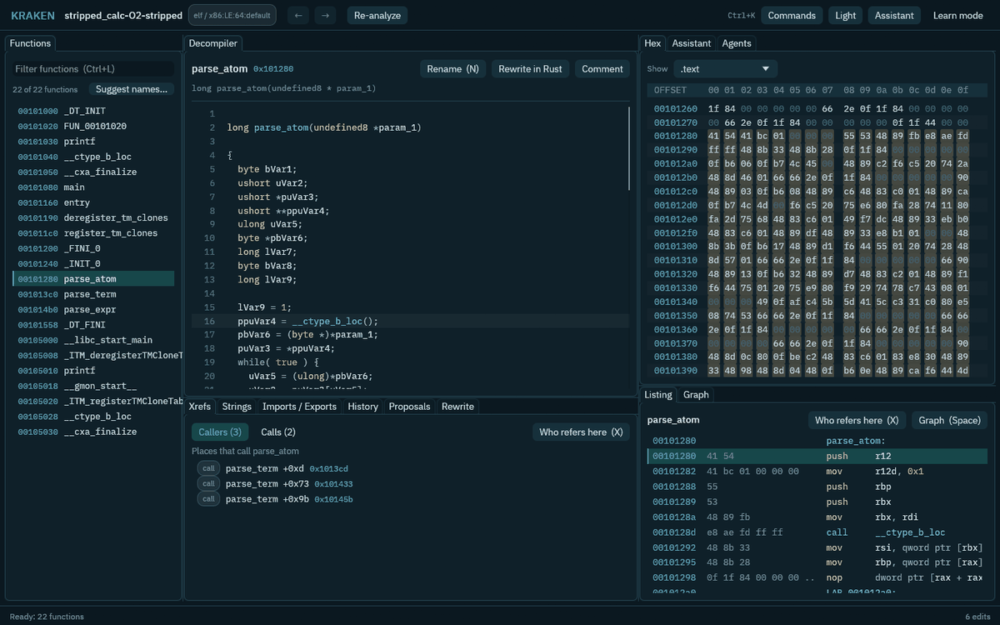

# Introduction

KRAKEN is an open-source reverse-engineering workbench written in Rust. It uses Ghidra as its analysis engine, so it can open native Linux (ELF), Windows (PE) and macOS (Mach-O) programs and turn them back into readable C-like code. You do not need to know reverse engineering to start. The app explains terms as you go, and an assistant can explain a function or suggest names for you to review.

If you are new, begin with the [tutorial](tutorial.md). In one session you take a program with no names, work out what it does, name its functions, undo a mistake and let an AI agent help.

## What you can do with it

- **Analyze.** Find functions, read the decompiled code and the instructions, see a function as a graph, follow cross-references, search strings.
- **Use AI, safely.** The built-in [assistant](assistant.md) works with a model on your own computer or in the cloud. Terminal agents such as Claude Code work inside the app or connect from outside over [MCP](mcp.md). Agents add to your project and propose changes; they never overwrite your work on their own.
- **Automate.** The command line, the MCP server, the GUI and the Python module all use the same set of commands, so what you click can be scripted: [CLI](cli.md), [Python](python.md).
- **Rewrite.** The goal KRAKEN is built toward is Rust rewrites of binaries, one function at a time, each checked against the original ([design](design/0013-rewrite-pipeline.md)).

KRAKEN keeps your edits (names, types, comments) in its own log, with the author of each one. Ghidra's project is a cache that can be rebuilt from that log. That is why every change can be attributed and undone.

## Where to go

| If you want to... | Read |
|---|---|
| Try it, with no experience | [Tutorial](tutorial.md) |
| Install it | [Install](install.md) |
| Use it from a terminal | [Getting started](getting-started.md) |
| Learn the vocabulary | [Concepts](concepts.md) |
| Know what it protects you from | [Security](security.md) |
| Understand how it is built | [Design decisions](design/README.md) |

KRAKEN is pre-alpha. Linux x86_64 is the platform to use today; macOS and Windows builds are experimental. Use it only on software you are permitted to analyse.
