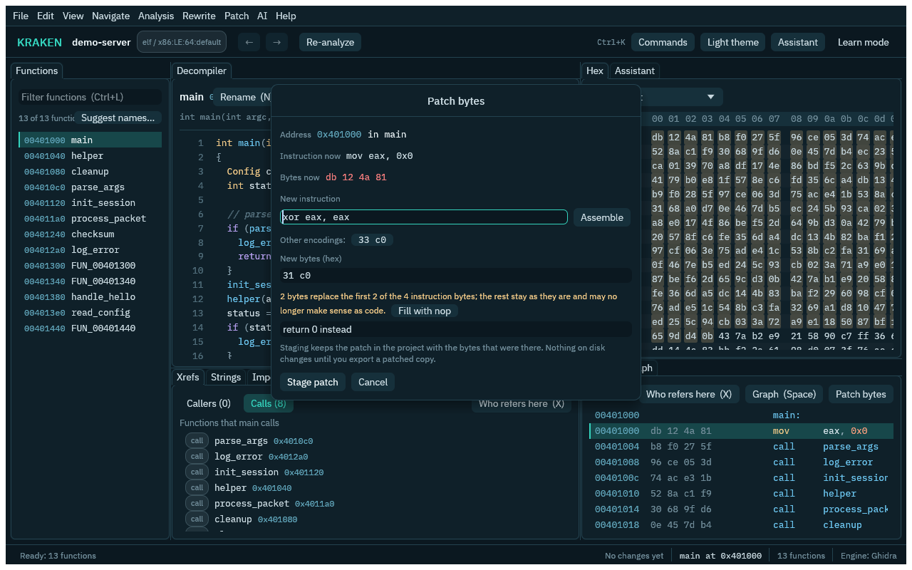
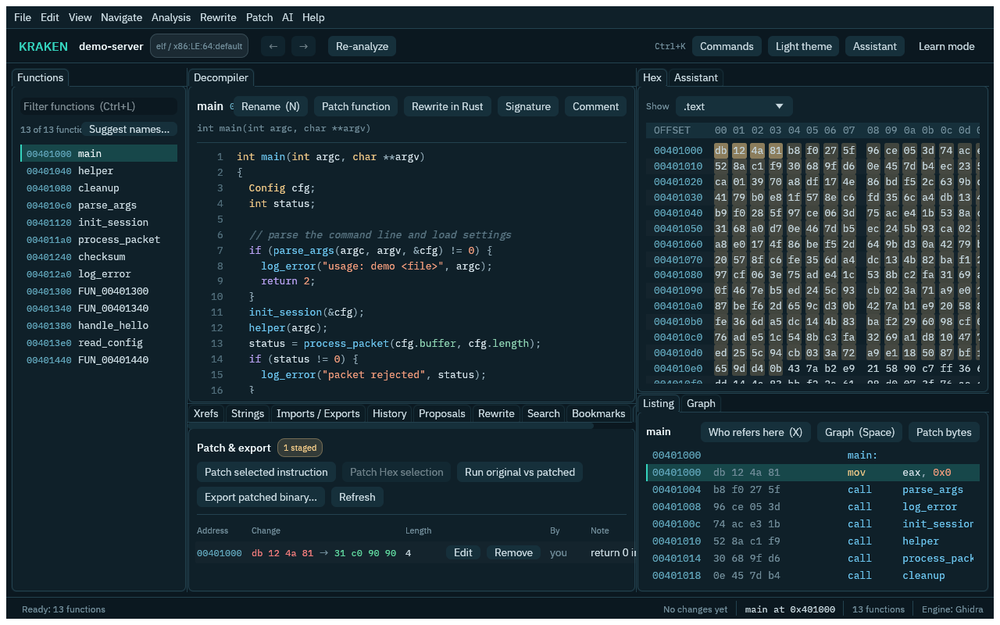
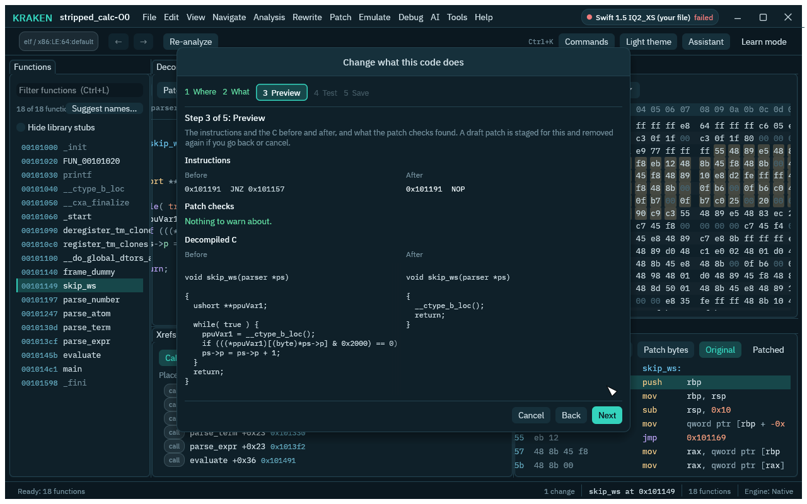
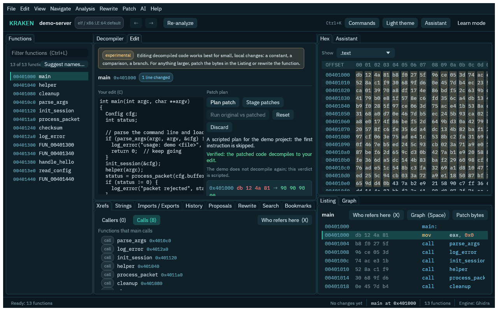

# Byte patching

Byte patches let you change a program's bytes — overwrite an instruction, flip a constant, blank a
call — and produce a patched copy of the binary, or run one in the emulator to see what the change
does. Patches are a separate overlay over the program's bytes; they are not analysis annotations and
they change nothing until you export or run them.

```
patch_set {"address": "0x401136", "bytes": "9090", "note": "two NOPs over the jump"}
```

## In the window

Everything below is also in the GUI, under the **Patch** menu:

1. **Stage a patch.** In the **Listing**, click an instruction and press **Patch bytes**; in the
   **Hex** view, select bytes and press **Patch selection** (or **Patch > Patch bytes here...**).
   The dialog shows the instruction and the bytes there now. Type the new instruction
   (`mov eax, 0x7`, in either case) and press **Assemble** or Ctrl+Enter: it is assembled for that
   address and its shortest encoding goes in the hex field, with the other encodings offered
   beside it. The field takes several lines, one instruction each (or separated by `;`). On the native engine, function and symbol
   names work as operands (`call cmp_id`), so do labels (`again: dec ecx; jnz again`), relative
   branches are encoded for the address they sit at, the result is decoded back through Sleigh to
   check it means what you typed, and it is padded with `nop`s to the next instruction boundary
   (a note says how many following instructions the bytes replace). When the replacement is
   shorter than the instruction it says so, and on x86 **Fill with nop** pads it with `90`. A
   longer one is flagged too, since it overwrites what follows. The Ghidra engine assembles with
   its SLEIGH assembler; the native engine assembles x86 and x86-64 itself, and ARM, AArch64 and
   RISC-V through `llvm-mc` when it is installed (otherwise it says so; type the hex). Branch
   targets for those are numbers, as `llvm-mc` reads them.
   

   **Edit a string.** On the **Strings** tab select a string and press **Edit string...** (or
   right-click it; in the Listing right-click string data and pick **Patch > Edit string...**).
   The dialog reads the string that is there, shows how it is stored (**Detect** looks at the
   bytes; ASCII, UTF-8 and UTF-16 little endian can be chosen) and counts the bytes of what you
   type against the room the old text leaves ("9 of 11 bytes"). Same length or shorter fits and
   the rest is filled with zero bytes, so the terminator stays and nothing after the string moves.
   A longer text is refused with how many bytes to cut. It is an ordinary patch you can undo.

   **Patch sets.** **New patch set...** on the Patches tab makes a named group with a description
   for the patches of one change ("debug logging", "English strings"). Pick the set in the
   patch dialog, in the **Set** column of the table, or with `patch_set`'s `group`. The checkbox of
   a set switches all its patches on or off: off patches stay staged (marked **off**) but are left
   out of **Export**, **Run original vs patched** and the emulator and debugger when they run the
   patched program. **Export set...** writes a copy with only that set's patches.

2. **Check it.** **Patch > Show patches** opens the **Patches** tab: every staged patch with its
   original and new bytes, note and author, with **Edit** and **Remove**. **Run original vs
   patched...** (also **Emulate > Compare original vs patched...**) asks for arguments, input,
   environment and files, runs the program twice in the emulator and shows the two runs side by
   side in the **Emulation** tab (see [Running the program in the emulator](emulation.md)). Staged
   bytes are tinted in the Hex view (which keeps showing the bytes on disk).
   

3. **Export.** **Export patched binary...** asks where to write the copy (type a path, a relative
   one lands in the project folder, or press **Browse...** for a save dialog), then asks for
   approval like every dangerous command. When it is written the window shows the file's
   **SHA-256** (with **Copy SHA-256**) and **Open folder**; the Patches tab keeps the last one.
   `patch_export` returns the same hash as `sha256`.

### Change what this code does (guided)

**Patch > Change what this code does...** (also in the right-click menu of the Listing and the
Decompiler, and in the command palette) walks through a patch in five steps, with Back and Cancel
on every one:

1. **Where.** The instruction you had selected in the Listing, or the line you right-clicked in the
   Decompiler. You can type another address. The window shows the function and the instruction.
2. **What.** Pick a card: **Skip this call** (NOPs the call), **Always take this branch**,
   **Never take this branch**, **Return a value** (the function returns your number as soon as it
   is called), **Change this constant** (the number inside the instruction) or **Write assembly**.
   Cards that do not fit the instruction (a call card on a `mov`) are off and say why.
3. **Preview.** The instructions before and after, what the patch checks (`patch_lint`) found, and
   the decompiled C of the function before and after (`decompile` and `decompile_patched`).
   
4. **Test (optional).** Arguments and standard input; **Run original and patched** runs both in
   the emulator (`patch_verify`) and says whether they behaved the same. Press Next to skip it.
5. **Save.** Name a patch set (an existing one or a new one, with a line on what it is for) and
   optionally write a patched copy of the program and/or a patch file of just this set. The box
   under the buttons lists the CLI commands that do the same.

The preview commands read the project's staged patches, so the wizard stages **one draft patch**
when the preview opens and takes it out again if you go back to step 1 or 2 or cancel (both are
undoable entries in the History). Nothing is written to a file before Save, and then only the
copies you ticked. If the address already has a patch, the wizard asks you to remove that first.
In the CLI the same steps are `patch_nop`, `patch_branch`, `patch_return`, `patch_constant` or
`patch_asm`, then `patch_lint`, `patch_verify`, `patch_group_set` and `patch_group_assign`.

### One-click patches

Right-click an instruction in the **Listing** and open **Patch** (in the **Decompiler** only
**Make function return...** and **Fill...** apply):

- **NOP this** replaces the instruction with NOPs in the processor's own encoding (x86 gets the
  multi-byte forms, ARM, Thumb, AArch64 and RISC-V their own);
- **Invert branch**, **Always take branch** and **Never take branch** change a conditional jump
  (x86 `jcc` short and near, ARM and Thumb `b<cond>`, `cbz`, `cbnz`, AArch64 `b.cond`, `cbz`,
  `cbnz`, `tbz`, `tbnz`, RISC-V branches); on anything else they say it is not a conditional
  branch;
- **Make function return...** makes a function return a number right away;
- **Fill...** fills a range with a repeated byte.

Each opens a small preview first: the bytes there now, the bytes that will be written and the
new disassembly. **Apply** records an ordinary patch, so it shows in the Patches tab and the
History and **Undo** takes it back. None of this needs an assembler, so it works on every engine.

The same intents are commands. Each takes `"preview": true` to show what it would write without
recording it:

```
patch_branch {"address": "0x401136", "mode": "invert"}
patch_nop {"address": "0x401140", "count": 2}
patch_return {"address": "0x401200", "value": 1}
patch_fill {"address": "0x402000", "length": 16, "pattern": "cc"}
patch_constant {"address": "0x401150", "value": 100}
```

`patch_constant` changes the immediate of one instruction without changing its length (x86
`mov`/`cmp`/`add`/..., AArch64 `mov`/`add`/`sub`/`cmp`, ARM and Thumb data-processing, RISC-V
`addi`/`lui`); a value the encoding cannot hold is refused instead of overflowing. Two patches
may not overlap: setting one over bytes another covers is refused (remove the old one first), and
for an agent it would never apply on its own. Replacing the patch at the same address is fine.

### Edit the C instead (experimental)

With a function open, **Patch function** in the Decompiler opens the **Edit** tab next to it:
the function's C, editable. Change what you want (a constant, a comparison, which branch runs)
and press **Plan patch**. The assistant's model gets the decompile, your edit and the disassembly
and plans the smallest in-place byte change that does the same; KRAKEN then checks the plan
before you see it:

- every patch must lie inside the function's instructions, replace bytes with the same number of
  bytes, and actually change something; the original bytes come from the disassembly, never
  from the model;
- the patched bytes are decompiled again: a copy of the binary with the patches goes into a
  temporary directory and a second engine of the project's kind decompiles the function, and
  the model compares that with your edit. The tab says **Verified**, **Partly verified**, **Not
  verified**, or **Not checked** when the second engine could not run, and shows the patched
  decompile. A failed check is planned again once with what it saw.



**Stage patches** stages the plan with `patch_set` (each patch's note says it came from your
edit); **Run original vs patched** then compares the two in the Emulation tab. It works best for
small, local changes: an edit that needs more room, a new call or new data comes back with no
patches and says why. Planning costs AI calls on the assistant's model (two per round) and asks
first like other AI work. The command behind it is `patch_from_source`, a job that only plans:

```
patch_from_source {"address": "0x401136", "source": "int f(void)\n{\n  return 7;\n}"}
```

The assistant can stage and remove patches too. Whether it may export is the assistant's
[danger mode](assistant.md#dangerous-commands-deny-ask-or-yolo): never (Deny), after asking you
(Ask, the default) or without asking (YOLO).

## How it works

A patch records an address, the **replacement** bytes you give, and the **original** bytes that were
there (read from the program when you set the patch). Keeping the originals means a patch can be
checked against the file before it is written and can be removed to get the exact bytes back.

Setting and removing a patch are edits in the project's edit log, like a rename: each shows in the
**History** tab with who made it and in which assistant or agent run, and **Undo**, undoing one
entry or undoing a whole run take it back (undoing a replacement brings the earlier patch back).
An agent's new patch applies at once; an agent replacing or removing a patch makes a proposal for
you to accept. Patches never reach the analysis engine and never alter the program you are
analysing. The commands:

- `patch_set` — record (or replace) the patch at an address. `bytes` is hex, with or without spaces
  and a leading `0x` (`"eb 10"`, `"eb10"` and `"0xEB10"` are the same two bytes). The replacement
  length decides how many original bytes are read; the address must be mapped and hold that many
  bytes. At most 4096 bytes per patch.
- `patch_remove` — delete the patch at an address, putting the overlay back the way it was.
- `patch_list` — every patch with its original and replacement bytes, note and who set it.
- `patch_export` — write a copy of the binary with every patch that is switched on applied;
  `group` limits it to one patch set.
- `patch_asm` — assemble one or several instructions (`;` or newlines) at an address and record
  them as a patch, padded with NOPs to the next instruction boundary; the answer lists the
  instructions replaced and the new disassembly, and `preview` records nothing (`patch_asm
  {"address": "0x401136", "text": "xor eax, eax\nret", "preview": true}`).
- `patch_string` — rewrite the NUL-terminated string at an address in `ascii`, `utf8`, `utf16le`
  or `auto`; the text must fit in the old text's bytes (the rest becomes NULs), a longer one is
  refused with how many bytes to cut (`patch_string {"address": "0x402010", "text": "Hello"}`).
- `patch_group_set`, `patch_group_list`, `patch_group_remove` — create a patch set (name and
  description), list the sets with their patch counts and on/off state, delete an empty one.
- `patch_group_assign` — move patches (by address) into a set, or out of any with `""`;
  `patch_group_enable` — switch every patch of a set on or off. Each patch changed is one logged
  edit, so they show in the History and `undo` flips them back; for an agent they are proposals.
- `assemble` — one instruction to its encodings at an address (`assemble {"address":
  "0x401136", "text": "mov eax, 0x7"}`), shortest first; nothing is written.

Recording and removing patches are ordinary reversible edits to the overlay — nothing is written
to disk and nothing runs — so they do not ask for approval. Producing a patched binary with
`patch_export` is the **dangerous** step and asks every time (ADR 0005), whether the caller is you
or an agent.

## Seeing what a patch does

The Listing and the Decompiler show the file as it is on disk, because patches are an overlay the
analysis engine never sees. To look at the patched program, flip the **Original / Patched** switch
in the header of the Listing or the Decompiler (it is one switch for both).

- **Listing, Patched.** Instructions a patch touches are decoded again from the patch bytes with
  the emulator's SLEIGH disassembler. They get an amber bar and tint in the gutter, and hovering
  one shows the bytes that are on disk, the patch's note and who set it. Flip a `jne` and it reads
  `jz`; overwrite a long instruction with `90` bytes and it reads as a run of `nop`s.
- **Decompiler, Patched.** The decompile stays the on-disk one until you press **Decompile
  patched**. That writes the patches into a temporary copy of the binary, opens it in a second
  engine of the project's kind and decompiles the function there (the first time takes a few
  seconds; the result is kept until the patches change). Your renames and comments are not in the
  copy. Nothing in the project or on disk changes.

The commands: `disassemble {"function": "0x401000", "patched": true}` returns the patched
instructions, each changed one with a `patch` entry (`original_bytes`, `patch_address`, `note`,
`author`); `decompile_patched {"address": "0x401136"}` returns the same shape as `decompile`.
Both are read-only and safe for agents. Without patches both equal their plain versions.

## Exporting a patched binary

```
patch_export {"output_path": "patched.bin", "overwrite": true}
```

`patch_export` reads the project's binary, applies every patch to a fresh copy and writes it to
`output_path` (a relative path is taken relative to the project directory). The original file is
never touched, and on Unix the copy keeps the original's executable permission so it stays runnable.

Each patch's address is turned into a file offset through the binary's own layout — ELF program
headers, or PE and Mach-O sections. The file's own virtual addresses are tried first and then the
native engine's load base for a position-independent executable, and the recorded original bytes are
checked at the mapped offset before anything is written. If a patch does not line up — an address
that is in no part of the file that holds bytes, or bytes that are not what the patch recorded — the
export is refused with that patch named, rather than a corrupted file being written. The result lists
each patch and the offset it landed at.

For a PE file the optional-header **checksum** is recomputed over the patched bytes, so a file whose
checksum the loader or a driver check looks at stays valid. An Authenticode signature is not touched:
it stays in the file and no longer verifies, which `patch_lint` says (below). Mach-O code signatures
are not handled.

## Sharing patches as files

A patched copy of a program is large and cannot always be shared. A patch file holds only the
changes, as offsets into the original file, and is what patchers, emulators and other tools read.

In the window, **Patch > Export patched binary...** has a **Format** choice: the whole patched
binary, or one of the patch file formats below. **Patch > Import patch file...** reads one back
(**Check file** lists what it would stage first).

```
patch_export_diff {"output_path": "fix.ips"}
patch_export_diff {"output_path": "fix.json", "group": "banner"}
patch_import {"path": "fix.ips", "preview": true}
patch_import {"path": "fix.ips"}
```

| Format | Extension | Write | Read | Notes |
| ------ | --------- | ----- | ---- | ----- |
| IPS | `.ips` | yes | yes | 3-byte offsets, so only the first 16 MiB of a file; run-length records are read |
| IPS32 | `.ips32` | yes | yes | 4-byte offsets |
| BPS | `.bps` | yes | yes | carries CRC-32 of the original, the result and itself; a file made for another binary is refused |
| JSON | `.json` | yes | yes | KRAKEN's own: offsets, addresses, originals, notes, and the file's size and SHA-256 |
| `.1337` | `.1337` | yes | no | text, one `offset:old->new` line per changed byte |
| DIF | `.dif` | yes | no | IDA's text difference file |

`patch_export_diff` writes the patches that are switched on (or one patch set) through the same
address-to-file-offset mapping as `patch_export`, with the same check of the recorded original
bytes. It is dangerous and asks every time. The format comes from `format`, or from the file's
extension. IPS cannot hold an offset past 16 MiB; the writer says so and asks for IPS32, BPS or
JSON. An offset that spells `EOF` in IPS is written one byte early so the file is not cut short.
For a PE file the recomputed checksum goes into the patch file as one more change, so applying
it gives the same file `patch_export` writes (and a BPS file passes its own target checksum).

`patch_import` is for files from other people, so it is strict. It reads at most 16 MiB and
100,000 records and expands at most 64 MiB of run-length data. Every offset is checked against the
project's binary with checked arithmetic. A BPS or JSON file whose original does not match the
binary is refused, as is a patch that would grow the file or change its size, a change in a part
of the file that is not loaded into memory (except a PE checksum, which is left out because export
recomputes it), an overlap with a patch already staged, and a file
with more than 500 separate changes. The file is read whole, laid over the original, and only the
bytes that really change become patches, so records that overlap or repeat settle to a clean
set. Nothing is staged unless the whole file is acceptable.

A person's import applies at once as ordinary patches under one run, so `undo_run` with the
returned `run_id` takes the whole import back. An agent's import never applies by itself: every
patch becomes a proposal for you to accept in Proposals, even though a new patch is otherwise
additive, because the file came from outside the project.

## Running a patched copy in the emulator

Pass `patched: true` to [`emulate_run`](emulation.md) to run a copy with the patches applied instead
of the original:

```
emulate_run {"patched": true, "stdin": "hello\n"}
```

The patched copy is built in the run's private directory and, like any emulated run, executes fully
confined — nothing runs on your computer and nothing in the project changes. The `notes` say how many
patches were applied. It is the quickest way to tell whether a patch does what you intended before
you export a binary from it.

## Checking patches before you export

`patch_lint` (the **Check patches** button in the Patches tab, or Emulate > Check patches) looks at
what the patches that are on sit on, without running anything. Findings are warnings, never errors:

- a patch over a **PE base-relocation slot** or an **ELF dynamic relocation** — the loader overwrites
  those bytes at start-up, so the patch does not take effect there;
- a patch that **spans the end of a function** (or starts in none and ends in one), which usually
  means the address or length is off (functions without a known size are not checked);
- a PE whose **checksum** field is set: it goes stale with any patch, and `patch_export` recomputes
  it (a note, not a warning);
- a PE with an **Authenticode signature**: any patch invalidates it. It is left in place, not
  stripped.

```
patch_lint {}
```

## Verifying a patch with inputs

`patch_verify` (the **Verify...** button in the Patches tab, or Emulate > Verify patches...) is
`emulate_compare` of the original against the patches that are on, with the arguments, standard
input, environment and files you give, and it keeps the result:

```
patch_verify {"stdin": "1 + 2\n", "argv": ["-v"], "env": {"MODE": "fast"}}
```

The answer is the comparison — both runs, each difference and the first point they diverge, shown
line by line in the Emulation tab — plus a **verdict** for exactly this set of patches. The verdict is
keyed by a hash of the addresses and bytes of the patches that are on (not their notes or sets), so
`patch_list` and the Patches tab show it on every patch of that set, and it disappears as soon as
a patch is added, removed, switched or changed, and comes back if the same bytes come back. "Changes
behavior" is what a patch usually aims for; "no change" means the input you gave did not exercise
it. The verdict is project state, not an edit-log entry, so `undo` does not remove it.
