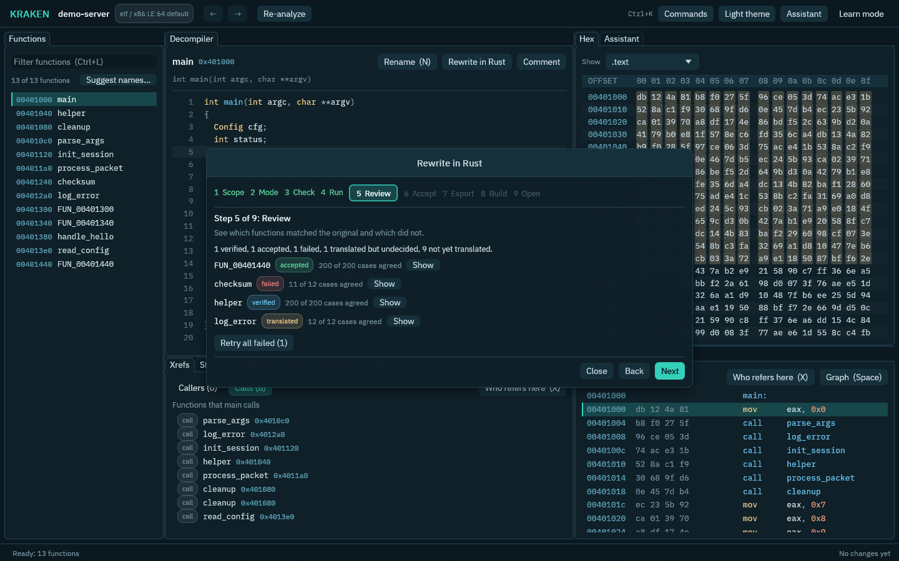

# Rewrite a program in Rust

KRAKEN can rewrite a program you have analyzed as Rust code, and check the Rust against the original program before you rely on it. This page walks through it from the first click to a Rust project you can open and build.

Before you start you need a project with an analyzed program (see [Getting started](getting-started.md)), an assistant that can write code (see [the assistant](assistant.md)), and a Linux computer with Landlock, because the Rust is only ever built and run inside a sandbox (see [What the sandbox does](#what-the-sandbox-does)). No demo is needed to look around: **Try the demo** on the welcome screen has a small program with a scripted rewrite that runs without a model.



## The short way: the wizard

Choose **Rewrite in Rust...** from the command palette (`Ctrl+K`), or press **Guided rewrite...** at the top of the Rewrite tab. A window walks through nine steps. Each step says in one sentence what it does, and when **Next** is off it says why, in plain words, under the steps.

| Step | What you do |
|---|---|
| **Scope** | Choose what to rewrite: one function, the plan (every function, callees first) or the whole program. |
| **Mode** | Choose **Translate the code** or **Write a spec, then reimplement**. |
| **Check** | See whether everything is in place: the assistant, the sandbox, the analysis, how many functions and requests to the assistant the job takes, and what the host provides (the Rust toolchain, the spec files the emulator needs, and whether the program is a kind that can be rewritten). A row that is not in place says what to do, with a **Copy the fix** button for the command, and **Check again** looks once more after you fixed it. |
| **Run** | Press **Start**. A progress bar shows the job, and **Cancel** stops it. When it ends the wizard moves on by itself. |
| **Review** | See which functions matched the original. **Show** opens a function in the Rewrite tab. |
| **Accept** | Accept what you trust. This step is yours: assistants cannot accept. |
| **Export** | Write the accepted functions as a Rust project in a folder. **Browse...** opens a file dialog. |
| **Build** | Compile the project and run its tests in the sandbox. The log of each step is shown. |
| **Open** | **Open folder**, **Open in editor** or **Copy path**. |

Closing the wizard loses nothing. A running job keeps going, and every result is in the Rewrite tab.

## What happens, step by step

### 1. Plan

The plan lists the program's functions with the ones that call nothing else first. A function is rewritten only after the functions it calls, so each translation can use the ones before it. Functions that call each other are rewritten together. Import stubs and compiler glue are left out. In the Rewrite tab, **Plan the rewrite** makes the plan, and **Plan again** makes it again without losing results.

### 2. Translate

For each function the assistant reads the decompiled C and writes Rust. KRAKEN builds that Rust in the sandbox. If it does not build, or is refused because it uses something not allowed (files, network, processes), the assistant gets the error and tries again, up to three times.

#### Steer a translation with hints

Open **Hints for the model** in a function's detail view to guide the next translation of that function: free notes ("the buffer holds UTF-8"), names for variables (`local_10 -> count`), the Rust type a parameter or variable should have (`a0: &mut [u32]`), `std` paths to import, and **Keep unsafe to pointer reads and writes**. **Save hints** keeps them with the project. **Retranslate with these hints** asks the model again with them and adds a new version; the older versions stay. The hints go into the prompt as instructions from you. They only change how the Rust is written: the tests and your acceptance still decide whether it is right. With the unsafe option on, a reply that uses `transmute`, `static mut`, inline assembly or unchecked indexing is rejected and sent back to the model like any failed attempt. Hints an agent set are passed to the model as data rather than as instructions. From a script: `rewrite_hint_set` and `rewrite_hint_get`, or the `hints` argument of `rewrite_function`.

### 3. Verify

KRAKEN runs the original function (in an emulator) and the Rust function on the same inputs, and compares the results and what they write to memory. A function that returns a pointer is compared by what the pointer leads to: the heap object it allocated (byte for byte, so a struct laid out differently is caught), or the string it points at. The status of a function says what came out:

- **planned**: nothing has been translated yet.
- **translated**: Rust exists, but the test could not decide (for example, the function calls a library function the test cannot imitate).
- **verified**: the Rust agreed with the original on every test case that ran.
- **failed**: the Rust differed, or did not build. A counterexample shows the input where it differed.
- **accepted**: you accepted this version.

Verified means the Rust agreed on the cases tried. That is evidence, not proof. Open the functions that matter and read the Rust.

Four controls in the detail view let you add to that evidence or overrule it:

- **Replay cases** builds the stored Rust again in the sandbox and runs every stored case on it, with no model involved. It also measures **coverage**: how many basic blocks of the original function the cases run (for example "Coverage 4 of 6 blocks"). The blocks no case reaches are listed with their addresses; click one to read it in the Decompiler. Code that no case reaches is not checked at all.
- **Add a test case** takes one value per parameter (a number, `"0x.."`, `{"hex": "00ff"}` or `{"text": "abc"}` for a buffer). KRAKEN runs the original on it for the expected result, keeps the case with the version and replays everything. A case that the Rust gets wrong fails the version, and an accepted version that fails is unaccepted.
- **Reject** marks the newest version as wrong or unwanted although it passed. It stays in the history and is never exported.
- **Unaccept** takes an acceptance back; the version goes back to verified.

In the Spec view, **Edit the spec** lets you correct what the model wrote. KRAKEN checks that every fact cites an address, and stores the edit as the function's newest spec, which "Rewrite from the spec" then uses.

### 4. Accept

Accepting marks one version of a function as the one to export. Accept a function in its detail view, or use **Accept all verified** in the Rewrite tab. That asks you to confirm and lists how many functions it will accept. Agents can translate and test, but accepting is reserved for you.

### 5. Export

The export writes a Rust workspace with two crates: a library with the accepted functions, and a shim that exposes each one under its original name. You can link the shim in place of the original functions one at a time, and the functions you have not rewritten keep running from the original program. When an accepted function calls one you have not accepted, the export calls the original function by its name; the README lists these calls, and a section **Check these before relying on them** lists accepted functions with weak evidence: stale (the decompile changed since), only compiled, no case compared, or cases that leave blocks of the function unreached. Functions that use globals need to know where the original program's data is: call `kraken_attach_image` once first (the README says how). The folder must be empty or an earlier export. A folder inside the project needs no question; a folder outside it asks first.

#### Run the Rust inside the original (Linux, x86-64)

`rewrite_preload_build` turns an export into a shared library for `LD_PRELOAD` and a launcher script, so the original program itself runs the accepted Rust. Nothing needs to be relinked:

```sh
kraken rewrite-export --dir export
kraken rewrite-preload-build --dir export --check-args '[]'
export/preload/run-with-preload.sh ./original-program args...
```

When the program starts, the library overwrites the entry of each accepted function in the running program with a jump to its Rust version. That covers static functions and calls through function pointers, which symbol interposition cannot reach, and the library also exports each function under its own name for calls that go through the dynamic symbol table. Functions that are not accepted but that the Rust calls are reached through trampolines to the original code. The data the Rust reads and writes is the program's own. With `--check-args` (a JSON list of the arguments to run with; `'[]'` for none) KRAKEN also runs the original twice in the sandbox, plain and preloaded, and reports whether exit status, output and error output are identical, plus how often each Rust function ran. `KRAKEN_PRELOAD_LOG=1` makes the library report the same on standard error; `KRAKEN_PRELOAD_DISABLE=1` turns it off.

Limits:

- x86-64 ELF programs on Linux. The library compares the size of the running program with the analysed file and leaves everything alone, with a message on standard error, when they differ.
- A function shorter than 14 bytes (the size of the jump) stays in the original. The result lists these.
- Functions that use the program's own `stdin`, `stdout` or `stderr` objects are not supported. A replaced function that prints writes through Rust's buffer, not the C library's, so its output can interleave differently with the original's when output goes to a pipe.
- A program that does not allow its code pages to be made writable, or that runs under another loader, is left unchanged. Statically linked programs ignore `LD_PRELOAD`.
- Export again after you accept more functions, then build the preload library again. Building and the checked runs happen in the sandbox; running the launcher by hand does not.

### 6. Build and test

**Build and test** runs `cargo build` and `cargo test` on the exported folder, inside the sandbox. For a whole-program crate you can also tick **Run the program afterwards** and give it arguments. Each step shows pass or fail, how it ended and its log. Only folders KRAKEN exported are built: the folder must hold the `manifest.json` or `kraken-program.json` file KRAKEN wrote.

## One function, the plan, or the whole program

- **One function.** The best way to start. Select a function in the Decompiler and press **Rewrite in Rust**, or choose it in the wizard. You see how a translation and its test look.
- **The plan.** Every function in turn. **Translate all planned** runs them one after the other in plan order, so the assistant is never asked for twenty things at once. **Retry all failed** runs the failed ones again, each in the mode it was last run in. Both show how far they are and can be stopped.
- **The whole program.** In the Rewrite tab choose **Whole program**. KRAKEN translates every function the program's entry point reaches, writes one standalone Rust program, builds it, and then runs the original program and the Rust program on the same inputs. It compares the exit status, what each prints and what each writes to standard error. If they differ, KRAKEN finds the function most likely responsible from the first difference, translates it again with that case as evidence, and compares again (the **Repair rounds**, 0 to 4).

For the whole program you can add **test cases** under **Options**: a name, the arguments to start the program with (quotes group words) and text for its standard input. KRAKEN also runs a baseline case and generated ones. **Check every function too** also tests each function on its own, so a failure points at one function; turn it off to only compile the functions and rely on the program comparison. Each case compares the exit status, the standard output, the standard error and every file the program leaves in its working folder. **Folder for the Rust crate** is where the crate is written; leave it empty for `rewrite-program` inside the project.

Running the whole program starts the original program on your computer (inside the sandbox, with no network). KRAKEN asks before it does.

### What a whole-program rewrite can handle

Ordinary C and C++ programs for Linux on x86-64 work, not just small examples:

- **Globals.** The program's data (globals, static variables, constant tables, strings) is copied into the Rust program as one shared block at the addresses the decompiler shows. Every translated function reads and writes the same block, so state that one function sets is seen by the next, as in the original.
- **Floating point.** `float` and `double` parameters and results, and the math library (`sinf`, `powf`, `sqrt`, `lroundf`, ...), with the same results as the original.
- **Files and the C library.** Programs that write or read files (`fopen`, `fwrite`, `fprintf`, `perror`, ...), parse numbers (`strtod`, `strtol`, `atoi`), sort (`qsort`) or use `rand`. The files each program writes are compared too, not just what it prints.
- **C++.** Methods (they are named after their class, for example `Button_begin`), destructors, lambdas, library templates compiled into the program (`std::vector` growth, `std::sort` helpers), `new` and `delete`, and errors that end the program (`std::length_error`) with the same message. Exceptions that are caught are not modelled.
- **Functions reached through pointers.** Callbacks, dispatch tables and vtables in the program's data are found when a function that runs uses the table, and the table points at the Rust functions.

The test of each function on its own is a help, not a gate. A function whose own test fails, or cannot run (for example because it needs a pointer to an object the test cannot build), is still put in the program and marked **not checked on its own** (`unchecked`). The comparison of the whole program decides, and when it finds a difference, the repair rounds translate the likeliest function again with that difference as evidence.

For example, two C++ audio simulators of about 30 and 47 functions (floats, globals, `std::vector`, `.wav` files) were rewritten this way and matched the original on all 11 cases, including the files they write. One needed a second run and two repair rounds. If a run stops part way, start it again: translations from earlier runs that are still valid are reused, so only the rest is translated.

Limits: Linux x86-64 programs only; at most six integer and eight floating-point parameters per function; no varargs functions of the program itself; no threads, no `fork`, no network, no clock; exceptions that are caught are not modelled. A model run is slow: with a terminal agent each function takes one to two minutes, so a whole program translates several functions at once (below).

### Faster: parallel levels and the cache

- **Several functions at once.** A function is translated after everything it calls, so KRAKEN sorts the program into levels: the functions of the first level call nothing of the program, the next level calls only the first, and so on. Every function of a level is independent of the others, so up to **4** are translated and tested at the same time (the members of a recursive group still go one after another). Callees always finish before their callers, and the crate and the verdicts come out the same whether 1 or 16 run at once. Change the number with `parallel` in the `[rewrite]` table of `config.toml` (`[rewrite]` with only `parallel = 8` keeps using your normal model), or for one run with `--parallel` / the `parallel` argument of `rewrite_program` (1 to 16). The job strip shows how many of the level are done and how many run at once. A cloud model may rate-limit you; lower the number if it does.
- **A cache of model answers.** Each answer is kept in the project, keyed by the exact prompt (which holds the function, its callees and your hints), the provider and the model. Asking the same thing again, for example a rewrite you start again after changing a setting, takes the answer from the cache: no model call, no cost. The answer is still built and tested like a new one, so the cache never replaces a check. An answer whose translation failed its test is dropped at once, so a repeat run asks again instead of repeating a mistake. The run summary says how many answers came from the cache.
- **See or clear it.** `rewrite_cache` (`kraken rewrite-cache`) shows how many answers are kept, their size and how often they were used; `rewrite_cache --action clear` (users only) empties it. Clearing it never touches translations, verdicts or accepted units.

## Translate or spec

- **Translate the code** is the default: the assistant writes Rust that does what the C does, quirks included. Choose it when you want the same behavior and when you do not yet understand the function.
- **Write a spec, then reimplement** first has the assistant write a plain description of the function, each statement tied to an address in the binary (click an address in the spec to jump there). It then writes the Rust from the description alone, without seeing the C. You get cleaner code and a document you can read, at the cost of one more request per function. The same test decides whether the Rust is right. Spec mode works function by function; it is not available for the whole program yet.

## What the sandbox does

The Rust comes from a model, so KRAKEN treats it as untrusted. It is built and run only in a confined process: the file system is read-only except for a private scratch folder, there is no network, memory, time and output are limited, and the environment is scrubbed. Before anything is built, a check refuses code that uses files, the network, processes, inline assembly or other things a translation does not need. If your computer cannot do this (Linux with Landlock ABI 4 or newer is required), the buttons that would build or run code are off and say so. There is no setting to run generated code without the sandbox. The sandbox shares your computer's kernel; for malware, use a virtual machine. See [Security](security.md).

Model requests send decompiled code to the assistant's service. The Check step shows which assistant is used and where requests go.

## What costs money

Every translation, spec, test fix and repair is a request to a model. A function takes up to 3 translation attempts (one more for its spec in spec mode); a whole-program rewrite takes that for every function the entry point reaches, plus up to 6 requests per repair round: often around 60 requests in all. On a cloud API that costs money; on a local model it is free; a terminal agent is billed by its own subscription.

- **Before a run** (the wizard's Start, Translate all planned, Retry all failed, Rewrite in Rust on one function, the whole-program run) KRAKEN shows the most requests, the model and the estimated cost range, and waits for you. `kraken rewrite-function` and `kraken rewrite-program` print the same and ask; without a terminal they need `--yes`.
- **While it runs** the job strip of the Rewrite tab shows the model and the calls, tokens and estimated cost so far, and so does the AI chip in the top bar. Stop a run in the **AI Activity** tab (or with `job_cancel`).
- **Limits** (Settings > AI, or `[ai_limits]` in config.toml) stop a run cleanly at a number of calls or an estimated cost, keeping every version already made; a daily budget refuses new runs until the next day.
- **A cheaper model for rewriting**: Settings > AI > Rewriting gives the rewrite its own model, and the Check step can change it for one run. The commands take `provider` and `model` for the same.

Costs are estimates from list prices; see [What costs money](assistant.md#what-costs-money) for the price table, the usage commands and the limits.

## Using it from an assistant or a script

Everything above is a command, so an assistant connected through [MCP](mcp.md) or a script using the [CLI](cli.md) can run the whole flow:

| Command | What it does |
|---|---|
| `rewrite_plan` | Plan the functions, callees first. |
| `rewrite_function` | Translate and verify one function (a job). |
| `rewrite_spec` | Write a cited spec of a function or the program (a job). |
| `rewrite_status`, `rewrite_unit` | Read the statuses, and the stored Rust, verdicts and versions of one function. |
| `rewrite_program`, `rewrite_program_status` | Rewrite the whole program and compare it with the original (a job), and read the run. `inputs` takes test cases, `dir` the output folder and `verify_functions` the per-function check. |
| `rewrite_cache` | Show how many model answers the project has cached, or clear them (clearing is users only). |
| `rewrite_check` | Check what the host provides: sandbox, Rust toolchain, spec files, program kind. |
| `rewrite_accept`, `rewrite_unaccept`, `rewrite_reject` | Accept a verified version, take the acceptance back, or reject a version. People only. |
| `rewrite_verify`, `rewrite_add_case` | Replay every stored case of a version and measure coverage, or add a case of your own first (jobs; no model is called). Agents may run them. |
| `rewrite_spec_edit` | Store an edited spec of a function. |
| `rewrite_export` | Write the accepted functions as a workspace (a job). |
| `rewrite_hint_set`, `rewrite_hint_get` | Set or read the hints that steer the next translation of a function. Agents may set them. |
| `rewrite_preload_build` | Build the `LD_PRELOAD` library that runs the accepted Rust inside the original program, and optionally compare a run with and without it (a job). |
| `rewrite_build` | Build and test an exported folder in the sandbox, and optionally run a program crate with `run_args` (a job). |

Jobs return a `job_id`; read progress and the result with `job_status` or `job_await`. `rewrite_program`, `rewrite_build` and `rewrite_preload_build` run generated code, so a call from an agent asks for your approval first. The [command reference](reference/commands.md) has every argument.

## If something does not work

- **A row of the Check step says Stop or Note.** Each row says what is missing. No Rust toolchain: install Rust with rustup so that `rustc` and `cargo` are on `PATH`. No spec files: run `kraken setup --native` (or `cargo xtask native-sla` in a source checkout, or set `KRAKEN_NATIVE_SPECS`); without them a translation is only built, never compared with the program. The same rows are available as the `rewrite_check` command.
- **The buttons are off with a note about the sandbox.** Your computer cannot confine generated code. Use Linux 6.7 or newer, or a kernel with Landlock ABI 4. A test or CI job that must have the sandbox can set `KRAKEN_REQUIRE_SANDBOX=1`: the sandboxed tests then fail instead of skipping on a host without it (`KRAKEN_REQUIRE_SPECS=1` does the same for the spec files).
- **No assistant is set up.** Choose one in **Settings**, or name a provider in your KRAKEN config file. See [the assistant](assistant.md).
- **Everything comes out translated, not verified.** The functions call library functions the test cannot imitate yet. Open one: its flags say which. The whole-program comparison still tells you whether the program behaves like the original.
- **Many functions say "not checked on its own".** Their own test failed or could not run, often because they take a pointer to an object (a C++ `this`) that random test inputs cannot build. They are still in the program; the program comparison is what counts.
- **The program differs in a file it writes.** The differences name the file, both sizes and where the first difference is (a byte, or a 4 KiB block). The repair rounds use the first difference of the output; a file difference alone is shown to you.
- **A function failed.** Open it in the Rewrite tab. The counterexample shows the input where the Rust and the original differed, and the history lists earlier attempts. **Retry** runs it again.
- **The build failed.** The log of the failing step is in the Build step. The Rust is the assistant's; fix it by hand in the exported folder, or run the function again.
