# Your first reverse-engineering session

This tutorial takes you from a fresh install to a program you understand, in about an hour. You do not need any reverse-engineering experience. If you can read a little C and are curious what is inside a program you have no source for, you are the audience.

We will take apart a small program that has had its names stripped out. At the start every function is called something like `FUN_00101280`. At the end they will have names that say what they do, and you will have used most of what KRAKEN offers: the function list, the decompiler, the listing and graph, cross-references, strings, the assistant, name suggestions with review, undo, an AI agent over MCP, and (optionally) the Rust rewrite.

**What "reverse engineering" means here.** A compiled program is a pile of machine instructions with no explanation. Reverse engineering is working out what it does and writing that down, usually by giving the pieces good names. KRAKEN does the heavy lifting (finding the functions, turning machine code back into C-like code) and keeps a careful record of everything you change.

A note on the pictures. Screenshots marked **real** were made with KRAKEN's own screenshot mode against the exact project in this tutorial, using the real Ghidra engine. Screenshots marked **illustrative** need a language model to answer, so they were made with KRAKEN's built-in demo project and a scripted answer. They show the layout and what to look for, not what a model will say about this program.

You need:

- Linux x86_64 (the only fully supported platform today, see [Install](install.md)).
- A copy of the KRAKEN repository, because the practice program lives in `corpus/bin/` of a checkout. Any other small program works too.
- About 3 GB of disk for Ghidra and a JDK, which `kraken setup` downloads once.
- Optional: a language model (local or cloud) for steps 9, 10 and 14, and Claude Code for step 13. Everything else works without one.

## 1. Install and run setup

**Do:** [install KRAKEN](install.md), then run

```sh
kraken setup
```

**You should see:** progress bars while Ghidra and a JDK download, then a line saying setup is done. It needs the network once, checks every download against a SHA-256 hash and never needs root. Running it again does nothing if everything is in place.

**Why it matters:** KRAKEN does not analyse programs itself. It drives Ghidra, a free analysis engine from the NSA, inside a locked-down child process. Setup puts that engine where KRAKEN can find it.

## 2. Create a project

**Do:** start the GUI with `kraken-gui`. Under **New project from a program**, press **Browse...** and choose `corpus/bin/stripped_calc-O2-stripped` from your checkout (or paste the path). Leave the project folder as proposed and press **Create project and analyze**.

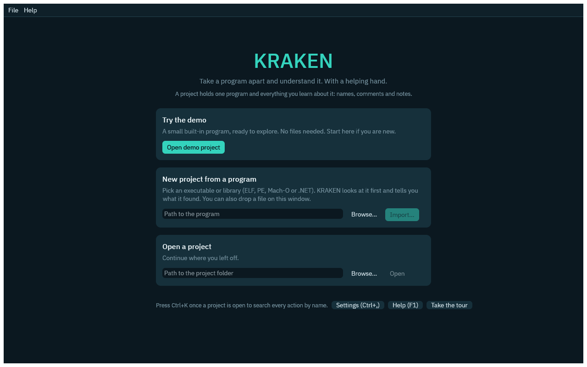

*Real: the welcome screen. The demo button is a good way to look around before you have a program of your own.*

**You should see:** a progress bar while Ghidra works. For this tiny program it takes under a minute.

**Prefer the terminal?** The same step is

```sh
export KRAKEN_PROJECT=~/kraken-projects/calc
kraken project-create --binary corpus/bin/stripped_calc-O2-stripped
kraken analyze
```

**Why it matters:** a *project* is a folder holding your copy of the analysis and, more importantly, every edit you make. The program itself is never run and never changed.

## 3. Read the function list

**You should see:** the main window opens with the **Functions** list on the left, 22 entries.

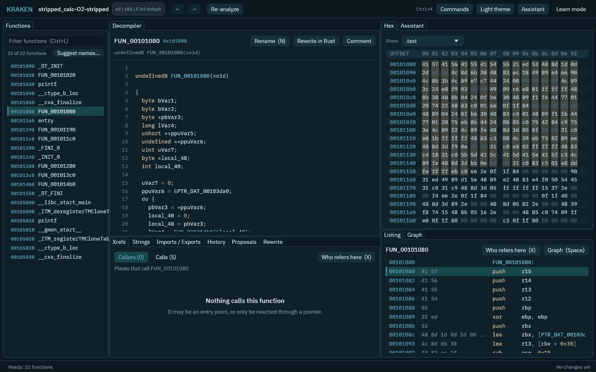

*Real: `stripped_calc-O2-stripped` right after analysis, with `FUN_00101080` selected.*

Read down the list. Some names are real: `printf`, `__ctype_b_loc` and `__cxa_finalize` are library functions the program imports, so their names survive stripping. `entry` is where the operating system starts the program. `_DT_INIT` and `_FINI_0` are startup scaffolding that Ghidra recognises from the file structure. The ones called `FUN_` followed by an address are functions Ghidra found but knows nothing about: `FUN_00101080`, `FUN_00101280`, `FUN_001013c0` and `FUN_001014b0` are the program's own code, and they are the ones we want to understand.

**Do:** click `FUN_00101080`. Use the filter box (Ctrl+L) to narrow the list if it grows long.

**Why it matters:** compilers throw function names away when a program is "stripped", which is how almost all software is shipped. Recovering meaning without them is the everyday job of reverse engineering.

## 4. Open the decompiler

**You should see:** the **Decompiler** tab in the middle shows `FUN_00101080` as C-like code. It will not look like the original source, with variables named `uVar7` and `local_48`, but the shape is readable: a loop, a few calls, two `printf` calls with format strings.

Even without a single good name you can read a lot from it. The function walks a table of pointers in a loop. For each entry it calls `FUN_001014b0`, then calls `printf` with either `"%-18s = %ld\n"` or `"%-18s : error\n"`, counts the errors and prints `"errors: %d\n"` at the end. That is a test driver: it runs something on a list of inputs and prints a result for each.

**Why it matters:** the decompiler (a feature of Ghidra) turns machine instructions back into C-like text. It cannot recover names, comments or types the compiler discarded, so treat it as a very good guess, not the truth. If something looks odd, check it against the instructions in the next step.

Look at the top right of the Xrefs panel: `FUN_00101080` has **Callers (0)**. Nothing in the program calls it directly. That is a clue: functions with no callers are usually entry points or are called through a pointer. This one is called through a pointer by startup code, which makes it `main`. Keep that in mind for step 11.

## 5. Look at the instructions in the Listing

**Do:** click the **Listing** tab (bottom right), or press **Space** while the graph is showing to swap between them.

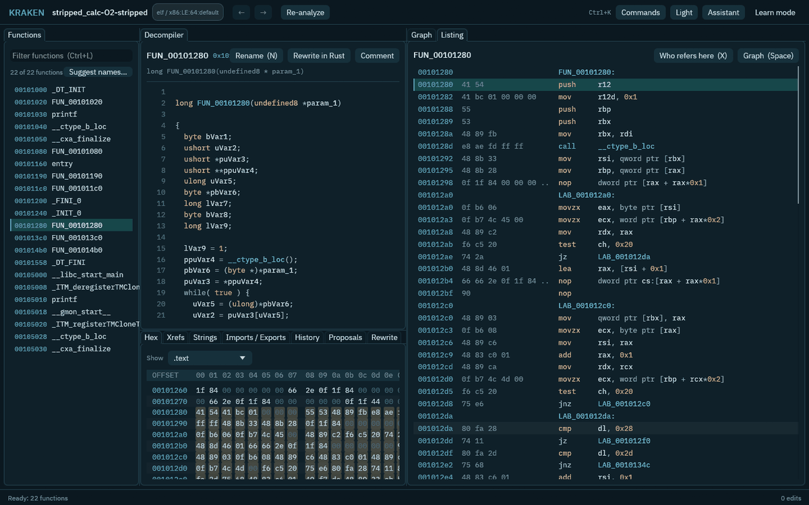

*Real: the instructions of `FUN_00101280`.*

**You should see:** one line per machine instruction: its address, the bytes it is made of, the mnemonic (`push`, `mov`, `call`, `jz`) and its operands. Names in the operands (like `__ctype_b_loc`) are links, and labels such as `LAB_001012a0` mark places the code jumps to.

**Do:** hover an instruction while **Learn mode** (top right) is on. KRAKEN explains the mnemonic in plain words. `kraken glossary jz` does the same offline in the terminal.

**Why it matters:** the instructions are the ground truth. The decompiler is built on them. When the C looks wrong, the listing settles the argument.

## 6. See the shape of a function in the Graph

**Do:** select `FUN_00101280`, then open the **Graph** tab (or press **Space** in the Listing).

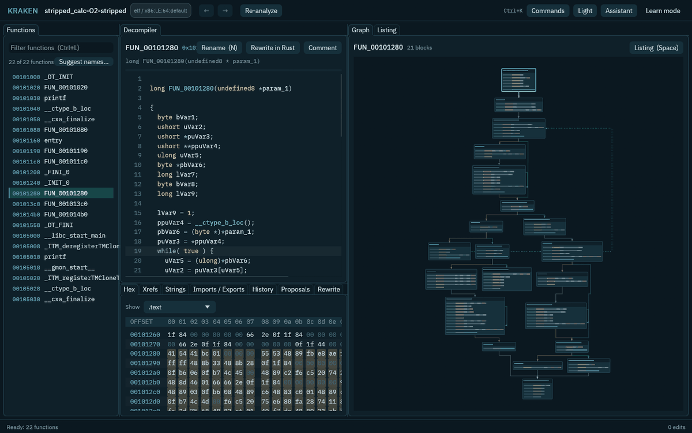

*Real: the control-flow graph of `FUN_00101280` (21 blocks).*

**You should see:** boxes ("basic blocks": runs of instructions with no branches) joined by arrows. Green arrows are taken when a test is true, red ones when it is false, and dotted teal ones jump back up. You can drag to move, scroll to zoom, and click a block to jump to it in the other views.

**Why it matters:** the graph shows structure at a glance. A dotted arrow going back up is a loop. A fork that quickly rejoins is an `if`. A function with lots of forks is doing a lot of deciding. This one reads characters one by one and branches on what it sees, which is what a small parser does.

## 7. Follow the cross-references

**Do:** with `FUN_00101280` selected, open the **Xrefs** tab. Press **X** over any address or name (or the **Who refers here** button) to ask who points at it.

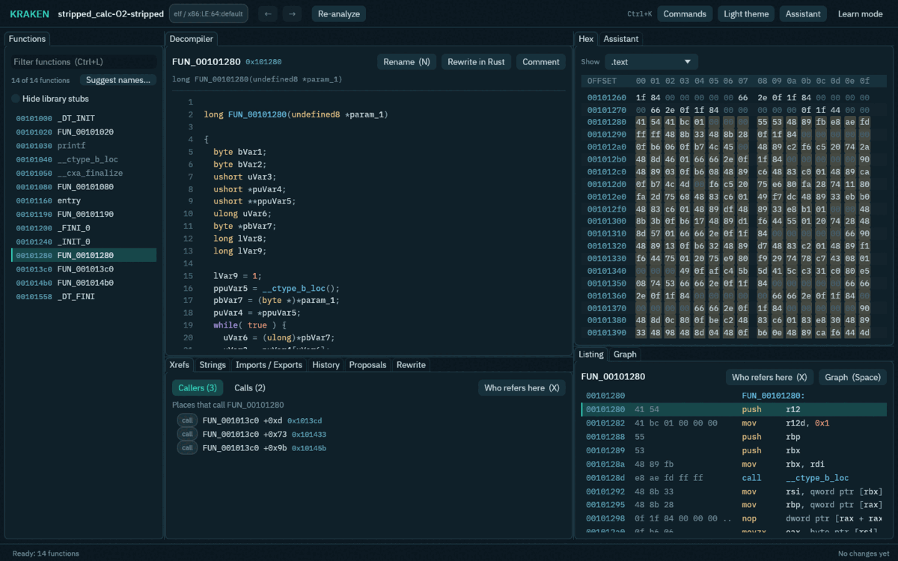

*Real: three call sites of `FUN_00101280`, each with its offset and address.*

**You should see:** **Callers (3)**. All three are inside `FUN_001013c0`. **Calls (2)** shows what this function calls in turn. Click any row to jump there.

Now you can walk the program. `FUN_00101080` calls `FUN_001014b0`, which calls `FUN_001013c0`, which calls `FUN_00101280`, which calls `__ctype_b_loc` (a character-classification helper from the C library) and also calls `FUN_001014b0` again, so the chain loops back on itself. Each step down is a function that does a smaller job.

**Why it matters:** a cross-reference ("xref") is a link between places in the program. Following xrefs is the main way to find out what a function is *for*: its callers show how it is used, and its callees show what it is made of.

## 8. Find strings

**Do:** open the **Strings** tab and type `%` into the filter. Double-click a string to see what uses it.

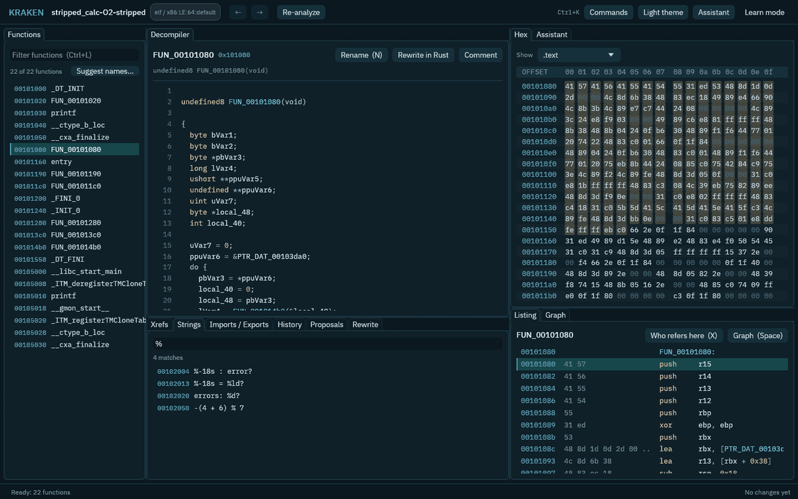

*Real: strings containing `%`.*

**You should see:** four matches, including `%-18s : error?`, `%-18s = %ld?` and `errors: %d?`. (The `?` stands for the newline at the end of the string.) Clear the filter and you will also find the test inputs: `1 + 2 * 3`, `(1 + 2) * 3`, `100 / (5 - 5)` and a few more.

Put the clues together. The inputs are arithmetic expressions, one of them divides by zero, one is cut off (`12 +`), and the output is either `= <number>` or `: error`. So `FUN_00101080` is a driver that feeds expressions to something and prints the answers. The chain below it is a small calculator.

**Why it matters:** strings are the cheapest clue there is. Programs print error messages, file names and format strings, and every one of them is a label written by the original author.

## 9. Ask the assistant to explain a function

You need something to answer for this step: a language model, or a terminal agent such as Claude Code if you already use one. Open **Settings > AI** (Ctrl+,) and pick one from the list (a local model such as Ollama keeps everything on your computer; an agent that shows *Needs setup* has a **Set up...** button that asks before it downloads anything), press **Test connection** (or **Test agent**), then **Save and use**. Both kinds work the same way in the Assistant tab. [The built-in assistant](assistant.md) and [Running a model on this computer](local-models.md) cover the choices.

**Do:** right-click a function in the list or code in the decompiler and choose **Explain this function**. The answer appears in the **Assistant** tab.

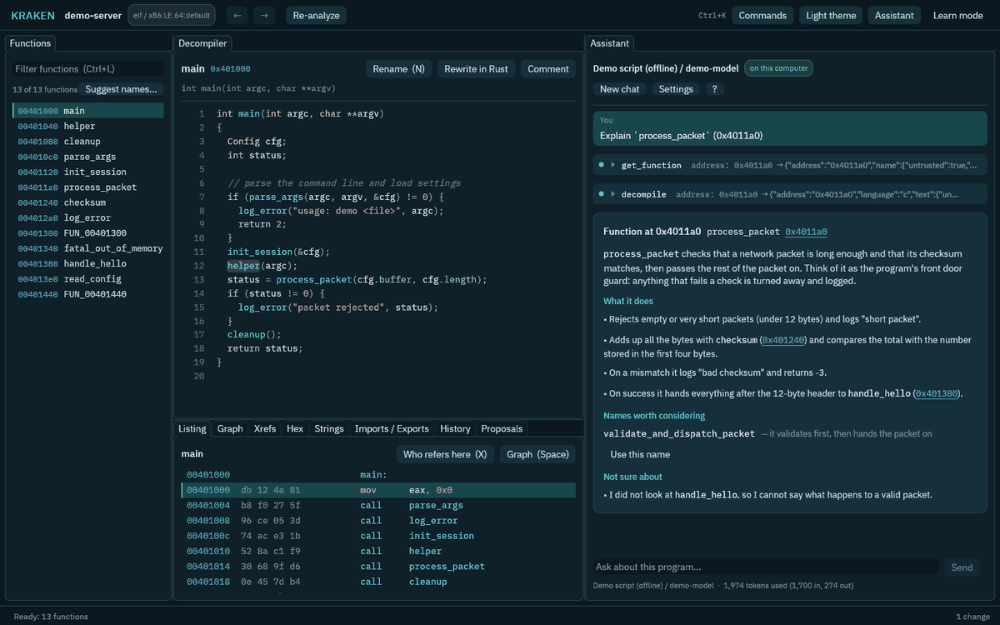

*Illustrative: the demo project with a scripted answer. With a model configured you get the same kind of card for your own function.*

**You should see:** a card with a short summary, a "What it does" list, a "Names worth considering" section with a button that opens the rename box with the name already typed in, and a **Not sure about** section for what the assistant could not check. Addresses in the text are clickable. Small chips above the card show which commands the assistant ran to look at the code.

**Why it matters:** an assistant reads decompiled code quickly, but it can be wrong and can be misled by whatever the program's text says. KRAKEN hands it the program's strings and names as clearly marked untrusted data, and the explain feature cannot change your project. Check its claims against what you saw in steps 4 to 8.

## 10. Auto-name with review

**Do:** press **Suggest names...** above the function list.

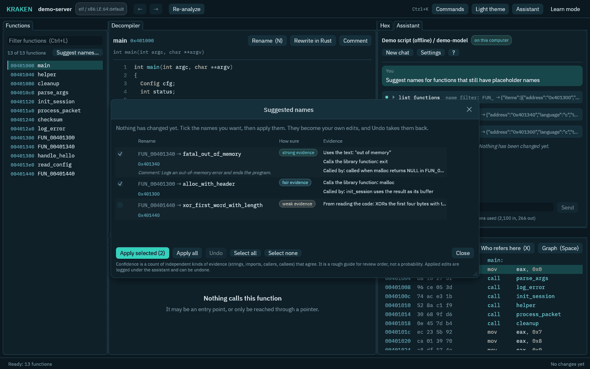

*Illustrative: demo project, scripted suggestions.*

**You should see:** a review table. Each row shows the old name, the proposed new name, a label (weak, fair or strong evidence) and the evidence behind it: strings the function uses, library functions it calls, and how its callers use it. **Nothing has changed yet.** Tick the rows you agree with and press **Apply selected**.

**Why it matters:** the evidence label is KRAKEN's own count of how many independent kinds of clue agree, not the model's opinion of itself. Treat it as a guide to what to check first. Applied names are logged as your own edits, so you can take them back (step 12). Weak guesses are a fine place to start reading and a bad place to stop.

## 11. Rename by hand

You do not have to wait for an assistant. You now know enough to name some of these yourself.

**Do:** select a function, press **N** (or press **Rename**), type a new name and press Enter.

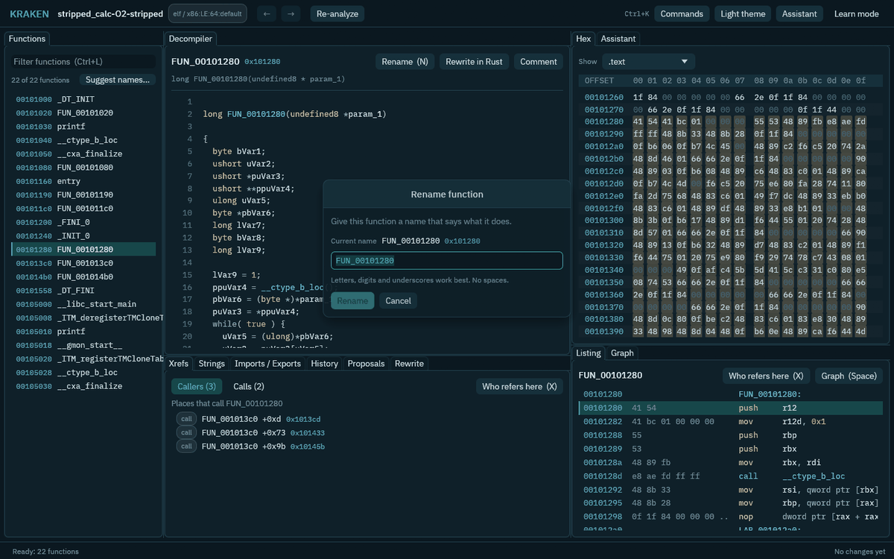

*Real: renaming `FUN_00101280`. The names `main` and `parse_term` in the list are from earlier renames.*

Here is one set of names that fits what we found. Try them:

| Address | Called | Why |
|---|---|---|
| `0x101080` | `main` | No callers, loops over test inputs and prints results |
| `0x1014b0` | `parse_expr` | Handles `+` and `-`, calls the next function down |
| `0x1013c0` | `parse_term` | Handles `*`, `/` and `%`, calls `FUN_00101280` |
| `0x101280` | `parse_atom` | Reads digits, `-` and parentheses; calls the character helper and starts over with `parse_expr` for a parenthesised part |

Notice how the decompiler text updates everywhere the name is used, so the code gets easier to read as you go. Take a second look at `main`'s decompiled code after you name `0x1014b0`.

Terminal version: `kraken rename-symbol --address 0x101080 --new-name main`.

**Why it matters:** naming is the whole job. A reverse-engineered program is just a program whose names you recovered, one at a time. Good names are worth more than comments, and they compound: each name makes its callers easier to read.

## 12. Look at the history and undo

**Do:** open the **History** tab.

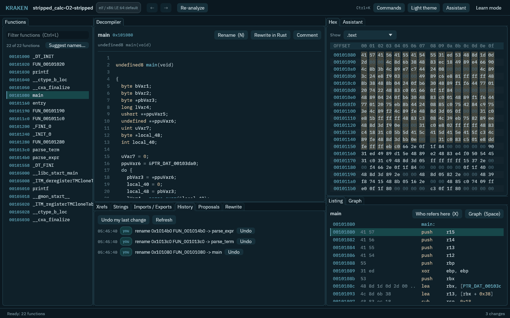

*Real: three renames, each tagged `you`.*

**You should see:** every edit, newest first, with the time, who made it (`you`), a description and an **Undo** button. Press **Undo** next to `parse_term`. Its name goes back to `FUN_001013c0` and the callers' text changes with it. Rename it again. **Undo my last change** undoes the most recent edit.

Some edits depend on others. If you undo a change that later changes were built on, KRAKEN tells you which later edits would go with it and asks first. In the terminal, `kraken undo-preview` shows this, and `kraken undo-entry` does it.

**Why it matters:** KRAKEN keeps an *edit log* and treats it as the truth. Ghidra's own project is just a cache rebuilt from the log. That is why you can try things freely: nothing is lost, everything is attributed, and anyone can see who changed what.

## 13. Connect Claude Code over MCP and watch it work

MCP (the Model Context Protocol) is how tools like Claude Code talk to other programs. KRAKEN speaks it, so an AI agent can use the same commands you do, on the same project.

**Do:** leave the GUI open on your project. In another terminal run

```sh
claude mcp add kraken -- kraken mcp --project ~/kraken-projects/calc
```

then start `claude` and ask for something small, for example: *"Use the kraken tools to find the C runtime startup functions in this binary and give them their standard names."* (Other agents work too, see [Connecting AI agents](mcp.md).)

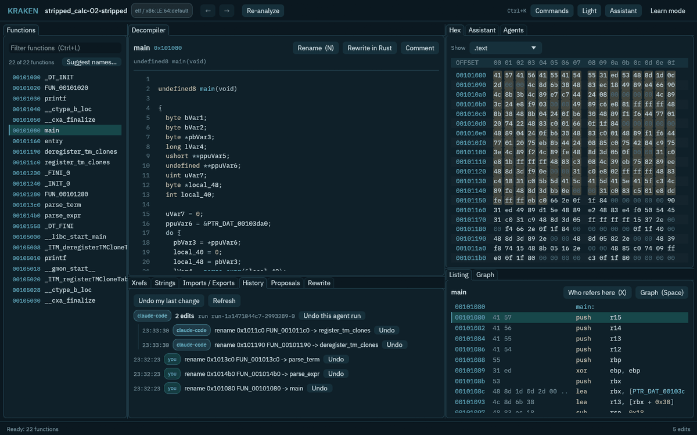

*Real, with a caveat: these two renames, `deregister_tm_clones` and `register_tm_clones`, were sent through KRAKEN's real MCP server by a small script that identifies itself as `claude-code`, so the screenshot shows exactly what an agent session looks like without needing a login. A real Claude Code session produces the same entries.*

**You should see:** the renames appear in the GUI as the agent makes them, with a notice and an **Undo** button, and in the History tab grouped as one *run* with the agent's name. **Undo this agent run** takes back everything that run did in one click.

The agent can add names and comments by itself, because adding to a placeholder name cannot destroy anything. If it wants to overwrite a name that you wrote, KRAKEN does not apply the change. It shows up in the **Proposals** tab as a suggestion that waits for you to **Accept** or **Reject**.

**Why it matters:** an agent can do in minutes what takes you hours, but it reads text that came from a file you do not trust. KRAKEN's rule is that agents add, you decide. See [Security](security.md).

## 14. Optional: try the rewrite pipeline on one function

The goal KRAKEN is built toward is turning a binary back into Rust you can read, one function at a time, with each translation tested against the original. This step needs a language model and a Linux kernel with Landlock, because the model writes code that KRAKEN has to run in a sandbox. Do it once you are comfortable with the rest.

**Do:** select a small function (here, `parse_atom` at `0x101280` is a fair test, or pick the leaf), press **Rewrite in Rust**, and open the **Rewrite** tab. The **Plan** lists functions callees first, because it is easiest to test a function whose helpers are already done.

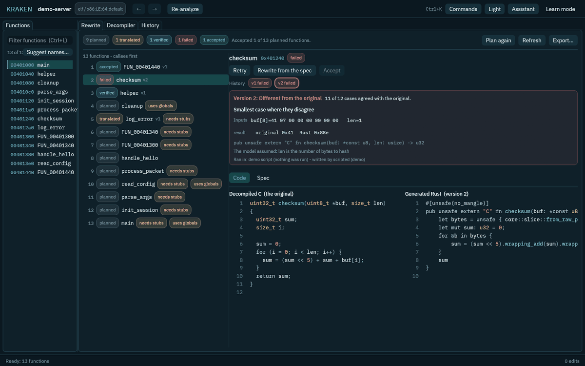

*Illustrative: the demo project with a scripted pipeline, including a failed attempt, so you can see what a counterexample looks like.*

**You should see:** a status for each function (planned, translated, verified, failed, accepted). KRAKEN runs the original function under emulation and the Rust version side by side on many inputs. If they ever disagree you get the smallest case that does, the input, what the original returned and what the Rust returned, and you can retry or rewrite from a written spec. A verified version can be **Accepted**, and only you can do that. **Export...** writes an ordinary Cargo workspace.

Terminal version: `kraken rewrite-plan`, then `kraken rewrite-function --address 0x101280`. See [The rewrite pipeline](design/0013-rewrite-pipeline.md).

When several functions are done, the **Whole program** section of the same tab rewrites all of them at once: it builds one Rust crate and runs the original program and the Rust program on the same inputs. KRAKEN asks before it does, because the original program is run (in the sandbox, with no network).

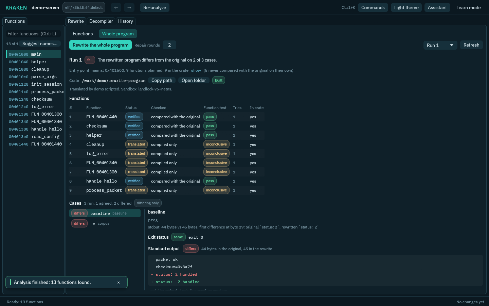

*Illustrative: the demo project's scripted history, a first run that differs from the original in one printed space.*

You see the program verdict, the table of functions with how each translation was checked (compared with the original on its own, or only compiled), the crate folder, and for every case the exit status, the standard output and the standard error of both programs. A line only the original printed starts with `-`, a line only the rewrite printed with `+`. If the program differs, KRAKEN finds the function the first wrong byte points to, has it translated again with that case as evidence, and compares again; the rounds are listed. Terminal version: `kraken rewrite-program`.

**Why it matters:** "it looks right" is not good enough for code you will ship. Running both versions on the same inputs turns a translation into something you can trust or reject.

## What you did, and where to go next

You went from a stripped program with no names to a map of how it works: an entry point (`main`) that drives a four-function expression parser (`parse_expr` calls `parse_term` calls `parse_atom`, which starts over at `parse_expr` for anything in parentheses), plus the C runtime's startup helpers. You can check yourself against the source, `corpus/src/stripped_calc.c`. We recommend not reading it until you have tried.

- Learn the vocabulary: [Concepts](concepts.md).
- Script what you did: [the CLI](cli.md) and [Python](python.md).
- Use Claude Code, Codex or Gemini CLI as the assistant itself, in the same chat: [The built-in assistant](assistant.md#terminal-agents).
- Try a harder program: `corpus/bin/cpp_shapes-O2-stripped` (C++ with virtual calls) or `corpus/bin/static_strops-O2-stripped`.
- Use only software you are permitted to analyse, and prefer a virtual machine if you ever run an unknown program yourself. KRAKEN runs the program you open only when you ask it to rewrite the whole program, and then only in a sandbox after asking you first.
